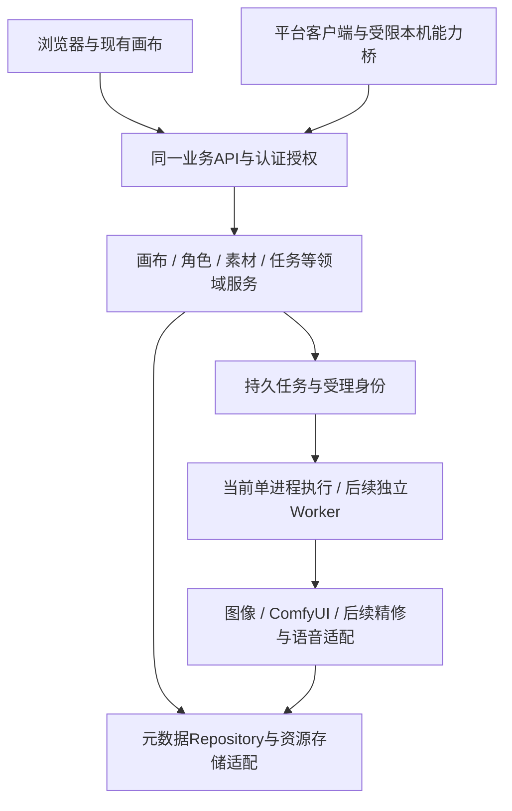

# Infinite Canvas Enterprise 当前架构

更新时间：2026-10-31

本次架构参考以产品源码 `0dce14f` 和 main `1c22861` 为基线。10.9 已发布；下方按日期记录的候选和状态描述仅代表当时，不能覆盖本段及 CURRENT。2026-10-24 收缩范围继续有效：部门/成员及渠道密钥保留，项目工作台、共享、费用页面和预算提醒不作为当前产品入口。文件级原子写入、媒体流式代理和 ComfyUI 单进程公平队列已随10.9交付，现场和规模验证分列。

2026-10-27本地可靠性包：`enterprise/local_json.py`只承担同目录临时文件、刷新和原子替换，调用方继续负责路径、锁与保存冲突；画布、项目目录、对话和历史复用该模块，单文件原子性不等于多文件事务或备份。`enterprise/proxy_transport.py`只负责有界请求读取、响应头和流式连接生命周期，Gateway/interceptors继续负责鉴权、隔离和逐SSE事件归属记录。JSON/HTML仍经原过滤/注入，媒体按段透传，不读完整下载后才响应；本轮无新服务、数据库或通用队列。

本文描述 main 已合并的运行架构、明确标注的开发候选与已确定的演进边界。实现状态以 [docs/CURRENT_PROJECT_STATUS.md](docs/CURRENT_PROJECT_STATUS.md) 为准，未来顺序以 [开发路线图](docs/roadmap/DEVELOPMENT-ROADMAP-2026-2027.md) 为准。

2026-10-22 发行接线已随 #194 合入 main：`migrations/canvas_workspace.release_registry()` 复用已审部门/目录DDL，供打包、全新安装及更新控制器使用。`build_release_manifest_v2.py --database-schema-version 2|4` 默认预置旧结构、显式选择部门结构；新装依据已验证Manifest初始化对应前缀，不在普通启动迁移。更新沿用原同结构预置、版本化迁移/备份恢复，已知旧目录按准确前缀维护。后续离线候选将相同引擎的已预置2→4接入原安装事务；共享 job/备份结果证明数据库替换，原槽位事务继续维护 EXE、Setup 和 Windows 登记。无新页面、迁移器或启动自动升级；源码、准确候选包、正式启用分别记录于CURRENT。

2026-10-24本地预览按负责人新取舍收缩：canvas-list恢复10.4原目录；HTTP管理适配器department_api仅注册成员、部门及渠道密钥，不注册项目/共享/费用/预算工作台路由。管理后台department-members与department-credentials分别调用组织和凭据服务；成员改版的admin-members呈现、admin-navigation导航、admin-embedded-pages既有页面容器和admin-members.css样式独立于业务服务，原账号操作经回调复用。个人中心和日志使用原页面的显式内嵌模式，不复制密码或审计API。management_context不再依赖项目列表。原画布所有权与任务身份/供应商适配继续独立运行，Schema4及历史事实保留，不做反向迁移。下文被退出的候选/早期模块说明保留历史角色，准确本地与正式状态见CURRENT。

## 2026-10-26 ComfyUI队列边界（当时的开发记录）

comfy_queue只负责ComfyUI准入、同算力分组名额和用户轮转，等待输入/任务仍由CanvasTaskDispatch及CanvasTaskJournal持久保存，Comfy已受理恢复不进入再次提交。journal按原写入刷新轻量内存索引；轮转顺序在重启时从同一任务的派发事实重建。comfy_queue_api将后台配置和本人用量经原Gateway上游客户端代理，管理员权限与执行身份仍由Gateway确定。admin-comfy-queue仅呈现设置，canvas-comfy-tasks仅呈现原输出状态和操作。配置使用STATE_ROOT/comfy-queue的原子JSON存储，无新增Schema、Redis或独立Worker；此增量现已随10.9交付。

## 1. 当前形态

2026-10-25共享控件：studio-select集中处理单选select与既有富参数面板的顶层显示、定位、键盘及互斥关闭，17个HTML入口显式依赖该组件。原表单和input/change处理继续负责业务动作；智能画布及聊天仅调用共享面板接口，不将组织、凭据、生成或存储规则放入控件。此增量现已随10.9交付。

2026-10-22 视频结果候选：`providers/video_outputs.py` 承接main原成片URL解析，排除尾帧/封面等明确非视频结果，保留旧嵌套与签名下载。`video_tasks`及原JSON提交/轮询使用同一状态判定，运行中不因预览链接提前成功；归档继续由main的资源路径/权限边界负责，无新Provider体系或任务队列。

当前是面向 Windows 单机/LAN 部署的模块化单体：

```text
Browser / LAN users
        |
        | HTTP + WebSocket
        v
Enterprise Gateway (0.0.0.0:8000)
  auth / permission / audit / admin / proxy
        |
        | user context, loopback only
        v
Canvas Application (127.0.0.1:3001)
  canvas / workflow / provider integration / static UI
        |
        +-- SQLite enterprise database
        +-- canvas/conversation/task JSON and metadata
        +-- asset/output files

Runtime Supervisor
  immutable Release + current pointer
  independent process ownership and health
  bounded restart/backoff and durable logs
```

这不是 PostgreSQL、多 Worker、共享对象存储或多节点高可用架构。`gateway` 与 `canvas application` 是同一产品内的两个进程；“Upstream”一词在代码里仍可能作为历史进程角色名出现，不表示产品继续依赖外部上游迭代。

专业企业服务器、私有化服务器和云服务器生产部署是已确认的长期产品目标。当前 Windows 单机/LAN 是已实现形态；Linux 运行兼容、标准服务管理、容器或其他服务器交付尚未完成验证，不能从 Python 源码的存在推导已可生产部署。

## 2. 主要模块

| 模块 | 当前职责 | 主要入口 |
| --- | --- | --- |
| Gateway | 登录、Cookie/JWT、请求和事件授权、HTML/响应治理、代理、管理入口 | `enterprise/gateway.py` |
| Interceptors/Policies | 路由分类、所有权过滤、功能开关、审计触发 | `enterprise/interceptors.py`，后续迁移到领域 Policy |
| Enterprise data | 用户、角色、归属、审计、版本化 migration/backup/restore | `enterprise/db.py`，`enterprise/migrations/` |
| Canvas application | 画布、工作流、模型调用、静态前端和原有业务 API | `main.py`，`static/` |
| Task journal | 两类画布任务持久回执基础 | `enterprise/canvas_task_journal.py` |
| 部门与凭据 | 当前管理入口保留成员、部门及渠道密钥；Schema4与历史费用事实保留，项目和费用工作台路由不注册 | `enterprise/department_api.py`，`enterprise/department_governance.py`，`enterprise/task_credentials.py` |
| 旧创作入口来源兼容 | 相关源码和历史身份事实保留；10.9撤下来源选择交互，新调用交互待重新设计 | `enterprise/legacy_call_sources.py`；具体可用路径以实际接线为准 |
| 供应商图像适配（#156 已合并） | 内置 Zhenzhen 已确认模型协议与能力；新模型临时兼容配置；与存储/Windows 生命周期分离 | `enterprise/providers/zhenzhen.py`，`enterprise/provider_image_profiles.py` |
| 个人模型显示（#156 已合并） | 当前登录账号的模型选择列表及持久设置；不授予供应商管理权限 | `enterprise/user_model_api.py`，`enterprise/user_model_preferences.py`，`static/js/model-picker.js` |
| 原任务续查 | 已受理 ID 的持久绑定、原任务查询与原回执结果，复用既有 journal/归属 | `enterprise/canvas_image_recovery.py`，`static/js/canvas-task-query.js` |
| ComfyUI 队列及取消 | 单上游任务受理、用户轮转、工作流等待限额及按原任务取消；不代表全供应商统一调度 | `enterprise/comfy_queue.py`，`enterprise/comfy_queue_api.py`，`enterprise/canvas_comfy_control.py` |
| 文件及代理传输 | 同目录临时文件原子替换；请求有界读取及媒体/SSE流式代理，授权和冲突规则由调用方维护 | `enterprise/local_json.py`，`enterprise/proxy_transport.py` |
| Runtime | launcher、supervisor、health、ownership、state/log | `enterprise/runtime/` |
| Release/update | Manifest v2、资产校验、prepare、pointer switch、rollback foundation | `enterprise/release/`，`enterprise/ops/update/`，`enterprise/update_api.py` |
| 已退出的部门项目/费用工作台 | 历史实现与数据可留存，不作为10.9已注册界面或API | 历史实现记录及10-24范围决定 |
| 经典画布媒体复用 | 按画布/节点/结果槽保留播放器；生成准备状态不写入持久画布 | `static/js/canvas-media-retention.js`，`static/js/canvas.js` |
| Enterprise UI | 登录、管理后台、个人中心、更新中心 | `enterprise-static/` |

Code Wiki 提供更细的文件、类和函数导航：[docs/code-wiki/README.md](docs/code-wiki/README.md)。

以下供应商/个人模型模块随 #156 合并并进入后续正式版本，准确状态回到 CURRENT。模型调用继续复用现有入口、结果归档和任务回执。长期接入供应商的参数差异由项目维护内置适配，普通用户只选择模型、画幅、参考图等创作参数，无需配置请求模板。Zhenzhen 图像模型的已确认协议分组与别名集中在 `enterprise/providers/zhenzhen.py`，按明确供应商身份及实际请求契约选路；文生图和参考图生成使用相应 JSON Generations，不探测多个付费提交入口。前端读取同一内置能力的公开投影，限制不支持的参数；已支持模型优先于历史临时模板。

临时模板默认折叠，仅供管理员在新上线模型尚未内置适配时配置兼容参数，不作为日常接入流程。该实现覆盖已确认的 Nano Banana、Gemini 3.1 图像、GPT Image 2 和 Seedream v5 Pro 图像契约；不等于供应商所有模型、视频协议、层分解输出或原生 Google 协议已经验收。新增同协议别名主要维护集中目录；新的提交/查询协议才增加适配代码。节点保留明确的画幅/分辨率选择，个人显示列表只影响选择体验。

个人模型偏好存于 `DATA_ROOT/user-model-preferences/<user_id>.json`，身份来自认证会话，以同目录临时文件原子替换；只清理本次写入自己的临时文件。该写入边界登记为既有 APP_ROOT 写入审计的 W50，不写安装源码目录，也不改动企业业务数据库 Schema。

`main.py` 中已有供应商调用、画布和工作流仍存在集中实现的技术债。本次将 Zhenzhen 新增图像请求构造与能力目录放在独立模块，主入口只连接现有 HTTP、资源转换和结果处理。其余供应商的模块化、统一持久任务/Attempt 和完整费用对账按唯一路线图阶段 4 落实；本次不构成自动最低价选路或不明状态跨供应商再次付费提交。

### 画布首页目录候选（2026-10-22 历史记录，10.9已退出）

`enterprise/canvas_workspace.py` 在原文件/所有权与部门项目策略上投影目录元数据，`department_api` 只接 HTTP；现有父级字段用于树，`migrations/canvas_workspace.py` 追加未激活 v4 的两张关联/归档表。没有第二任务队列或画布副本。`canvas-workspace-boot.js` 按已受控升级的能力选择新目录 UI，旧 schema/独立 main 保留原脚本；网格/列表用现有主题、图标和原编辑器，个人范围仍可进入旧自由布局。公开项目只返回明确关联的目录元数据；原资源和完整画布继续由既有所有权策略约束，完整只读预览另行接线。

### 项目任务与完整画布共享候选（2026-10-22 历史记录，10.9已退出）

`enterprise/project_results.py` 在既有任务所有权、journal与冻结业务归属上投影任务/归档成果；`shared_canvases.py` 依据明确项目关联与现行项目策略读取完整创作结构，过滤凭据，按请求重查资源授权。复用以独立资源所有权落在现有存储及原画布创建/保存流程，不执行供应商请求、不继承待运行任务。既有费用接口和角色权限保持，目录共享本身不授予全局资源访问。

前端 `project-results.js` 接原首页任务/成果及共享设置；共享画布直接导航原编辑器，`shared-canvas.js` 仅提供只读控件与保存副本，原编辑器停止自动保存和任务续查，保留原渲染/连线/媒体查看。`department-members.js` 增强现有管理后台成员页；`department_governance.member_workspace` 返回角色可管理范围，Gateway只允许现任部门负责人进入此受限页面，原公司管理API不放权。本包依赖未激活v3/v4，无新增Schema或第二业务页面。

两类显式素材副本的写入沿用 W15 的 `UPLOAD_ROOT/assets/output` 流程，并登记到既有写入清单；异常清理只删除该次创建的文件，不清理原项目素材。

## 3. 安全与权限边界

历史候选曾将费用分页及站内预算提醒接入 `DepartmentCosts.entries/budgets/summary`；按10-24决定，10.9不注册费用/预算工作台路由或展示这些页面。历史费用事实保留，不能据此声称当前提供费用视图。

- 对外仅暴露 Gateway；`:3001` 必须绑定 loopback。
- UI 隐藏不是权限控制，API、WebSocket、后台任务和资源访问必须服务端授权。
- 普通用户对未知 owner、未知路由和未知事件应默认拒绝。
- 超级管理员能力是显式授权，不由普通管理员身份隐式继承。
- Cookie、Origin/Host、登录跳转、静态文件路径和代理目标均需独立校验。
- 数据库约束/RLS（后续 PostgreSQL）是纵深防御；业务授权仍负责返回稳定的产品错误和审计信息。

SEC-P0 已通过 PR #119 合并，#111 已关闭；后续加固与管理员操作 403 仍需按精确治理状态回归。不能放宽授权来消除错误提示，也不能以已有角色表宣称所有权限场景均已验收。

## 4. 数据与存储

### 当前事实源

- 企业结构化数据：SQLite。
- 画布、对话和部分任务：文件/JSON 与 SQLite 映射并存。
- 图片、视频和输出：文件系统保存字节，数据库/JSON 保存路径和归属。
- 配置、Runtime 状态、日志和 Release 分属 `CONFIG_ROOT`、`STATE_ROOT`、`LOG_ROOT`、`INSTALL_ROOT/releases`。

### 固定不变量

- 数据从创建时就具有 owner/org/project 语义；不能依赖后补归属。
- 大型资源字节不进入普通业务数据库事务。
- schema 变化必须带版本、迁移、验证和恢复计划。
- 画布引用资源 ID/版本，不长期写死绝对磁盘路径。
- 任务和费用是可审计事实，不以进程内内存作为唯一状态。

### 近期缺口

DATA-MVP-1 与 UPDATE-DATA-1 已通过 PR #120/#121 复核和接入主线，PR #130 补齐旧库先备份再登记保护。新增表仍须验证准确来源、迁移步骤、数据保留与失败恢复；基础引擎通过不等于全部客户结构兼容。

文件/JSON、数据库和审计有不同状态，持久格式同样要版本化。两类任务回执不等于统一任务平台、费用账本和对账。

## 5. Runtime 与健康

Runtime Supervisor 分别管理 Gateway 和 Canvas application，并持久化运行状态、日志、进程 identity 和 generation。存活、就绪与业务健康的语义必须分开：

- liveness：进程/事件循环是否能响应，不访问外部 Provider。
- readiness：实例是否可接收业务流量。
- dependency health：数据库、Canvas application、Provider 等依赖状态。

短暂依赖失败应进入 degraded，不得直接导致 Gateway 破坏性重启。真实进程退出才进入带退避的恢复。主要修复已通过 PR #108 合并；真实 Windows 服务、安装副本回调和客户使用是不同证据层级。

## 6. Release 与在线更新

主线已有不可变 Release、Manifest v2、准备、数据迁移/恢复、一次确认和准确路由检查。正式 10.1 来自维护线，是 09.9 同数据库结构的后台维护包，不是 main 全量发布；两台设备成功反馈与剩余限制见 [CURRENT](docs/CURRENT_PROJECT_STATUS.md)。

本轮统一开发基线接回 `ice_096_security_schema_v2` 登记、v2 snapshot 和构建模式。默认未来构建生成与正式 09.9/10.1 同源的 30 对象/schema v2 证据；Greenfield 按已验证包内 evidence 选择受支持的 v1/v2 初始化并验证元数据/账本/结构，固定入口、密码和 pointer-last 保护保留。普通启动不隐式迁移旧库，28 对象历史变体不默认开放；历史资产须从冻结 refs 重建，不能用当前源码的旧 VERSION 标记伪造旧包。

主要缺口是阶段 3 在线交接收口、准确来源及 GUI 覆盖，以及完整任务/业务写入隔离。目标 Python 执行器、原生工具和连续路径已随 #154/#155 进入主线，在线交接缺口与验收范围仍分别记录。遵循 [统一交付 ADR](docs/decisions/ADR-DELIVERY-001-UNIFIED-INSTALL-UPDATE-LIFECYCLE-2026-10.md)。下面是目标完整流程，不声称每一步都已落地。

C5 开发分支新增 [经验证的目标更新执行器接管](docs/ops/VERIFIED-UPDATER-HANDOFF-2026-10-11.md)：纯读取契约独立声明控制器协议、worker 协议和引擎能力版本；完整包及持久计划核验后，目标代码/目标 Python 运行既有单跳事务，数据和状态仍归同一安装。无契约的不可变旧包沿用来源引擎，有但不可验证的契约拒绝交接；不弱化进程 lease、Job 独立性或恢复阻断。它不是原生 EXE 替换或自动多跳，也不扩展未知 Schema 的迁移授权。Windows 执行路径留在现有平台交付/Runtime 边界，不增加核心业务的桌面或注册表依赖。

目标单机更新事务：

```text
authorize
  -> check compatibility
  -> download and verify immutable assets
  -> notify users / stop accepting long tasks
  -> drain or checkpoint tasks
  -> backup database + business metadata + config
  -> apply schema migration and verify
  -> switch Release pointer
  -> start and health-check
  -> commit success
     or restore data + pointer and report recovery state
```

单跳已有持久作业和恢复查看基础；C7 协调器通过最新目标包内的协调器执行整条已授权路径，各跳仍复用单跳事务，不创建另一套数据库迁移引擎。网页、固定 EXE、安装器和恢复界面必须共用引擎：Python 承担业务/迁移，C# 仅做系统交互，安装器编排。

C6 [离线保留数据升级记录](docs/ops/OFFLINE-RETAINED-UPGRADE-2026-10-12.md) 复用上述引擎，在明确停止来源服务、相同 Schema 和可证明安装身份下恢复来源并升级程序、固定 EXE 与保留维护 Setup；分别保存对象身份和检查点。成功目标等待 Windows 登记时暂停其 HTTP/WS 业务，登记核验后完成。成功后的登记故障不触发数据库或来源版本回退；该粗粒度暂停不是持久任务排空、完整业务维护态或自动多跳。Windows 专属登记/文件操作不进入企业业务模型，候选/GUI/合并/正式发行分别记录。

#151/#152 已将归属缓存清理、实例标准卸载、同 Release 保留数据重装和持久恢复合入 main；C6 实现已补证标准卸载确认和限定跨版本 GUI，完整维护矩阵及长期闭环仍未完成。C4 [发布目录工程记录](docs/ops/UPDATE-CATALOG-PAGINATION-2026-10-11.md) 已经 #153 合入 main，将 v1/v2 元数据读取共用到分页目录：临时内存缓存按仓库/凭据身份隔离，每次 HTTP 条件核验全部页面，读取失败不作为升级事实源。路线缓存仅用于不可变声明的页面预览，准备和执行仍重新核验；不新增业务数据库、Windows 核心依赖或缓存 TTL 政策。

失败恢复应在开放业务写入前完成；已经接受新数据后不能还原旧快照。PostgreSQL 及多节点有独立排空、备份/恢复和发布协议，不照搬 SQLite 文件替换。

## 7. 目标演进

任务顺序只在 [唯一路线图](docs/roadmap/DEVELOPMENT-ROADMAP-2026-2027.md) 维护。

| 已确定角色 | 数据目标 | 实现边界 |
| --- | --- | --- |
| 长期保留单机版 | SQLite 业务数据与本地素材 | 不是多节点共享库 |
| 团队服务端 | PostgreSQL＋受管理存储 | 当前客户仍为 SQLite，产品迁移单独验证 |
| 员工桌面客户端 | 服务端业务事实；本地 SQLite 缓存/设置 | 尚未交付，不自动给每个员工装服务器 |

本地与企业服务器/云端部署复用业务领域模型、API、服务端权限契约和稳定资源身份；员工端消费同一业务契约，不复制业务系统。Windows Registry、Job Object、KnownFolder 和桌面交互留在平台适配层；业务核心不新增固定盘符或必须由桌面启动的依赖。

当前仍按单台 Windows 主机交付；Linux、云部署和规模容量实施待负责人需求，不作为本轮新增任务。后续服务器运行能力随正式工作包建立：先评估 Linux 真实依赖与阻碍，再落实配置外置、无交互启动/停止、健康检查、日志、权限/网络边界及可重复部署。公开入口须核验 TLS、可信反代、网络隔离、访问限制、身份/密钥与审计。跨企业采用共享 SaaS、每客户独立部署还是混合形态尚未确定；部门 Owner 隔离不能替代企业租户边界。

单企业未来 1—2 年的设计目标为 500 名以上员工、200 名以上同时活跃创作；不是现有容量或 200 个同时付费请求的承诺。后续使用 100/200/300 活跃用户的混合负载，观察 API/WebSocket、画布保存、AI 受理与查询、数据库写等待、素材读写和队列积压，再按瓶颈选择 PostgreSQL、独立 Worker、受管理文件/对象存储、传输缓存或多实例协调。高可用按业务可靠性目标演进；RPO/RTO、预算、云供应商及拓扑仍待负责人确认。不预设微服务、Docker、Kubernetes 或 Redis 为前置目标。

持久任务/Provider Attempt/回执/费用/审计、事务与版本冲突、Repository 和 Storage Adapter、格式迁移及失败恢复随 B13/B14/B15/B16/B17、N29/N34/N37 的对应实施授权一并落实。容量和服务器要求不改变当前阶段 3 顺序，也不豁免客户数据与更新恢复门禁。Vue 3＋TypeScript 是局部试做方向，不表示已迁移；桌面框架仍须比较验证。

模块化原则是按业务域逐步提取 Policy、Application Service、Repository、Provider Adapter 和 Storage Adapter；不做一次性重写，也不继续把新业务规则堆入 `gateway.py` 或 `interceptors.py`。

### 7.1 2026-10-28 持续迭代、网站与客户端专项评估

本节核对的是 `manual-acceptance` 工作区、HEAD `89f75d8` 及当日本地未提交代码，不将预览改动写成10.9发行能力。负责人要求提前评估持续新增功能、类似Liblib的网站与平台客户端，并调研角色造型室的完整功能等价实现。结论：业务方向和Python/FastAPI模块化单体路线可继续使用；当前实现尚不足以直接交付可横向扩容的网站平台、完整员工客户端或共享多企业SaaS。现有架构原则基本正确，但代码边界尚未完全落实，必须从本次新增复杂功能开始执行，不能只把整改留在未来规划中。

| 目标 | 本次判断 | 必须先满足的条件 |
| --- | --- | --- |
| 在现有单机/LAN产品持续新增功能 | 可继续，复杂功能必须独立成模块 | 明确服务、存储、任务、权限和画布接入边界；保持已有客户数据及入口 |
| 实现类似Liblib的创作功能与交互 | 可分阶段实现功能等价；当前未完成 | 逐项核对界面、算法/模型和保存复用链路，不以界面相似替代真实能力 |
| 企业服务器网站与多客户端接入 | 路线可行，当前不是完成态 | 业务API、并发冲突、任务执行边界、服务器交付和兼容测试 |
| 多服务器或公开多企业平台 | 当前不能直接按此部署 | 共享任务协调、服务端数据库/存储、租户隔离和实测容量；部署形态仍须产品确认 |
| 平台桌面客户端 | 可复用同一业务核心，尚未交付 | 薄客户端、本机能力桥接、缓存/下载、API版本兼容及独立更新 |

### 7.2 已定位的风险及整改时机

以下是源码证据和由其得出的风险判断，未以文件行数直接判定缺陷，也未执行本轮容量压测或双端并发保存实验。行数按UTF-8源码物理行计算，含空行，只是本地快照。

| 事实/定位 | 风险 | 整改时机与完成依据 |
| --- | --- | --- |
| `main.py` 17,198行；`static/js/canvas.js` 15,109行、828个函数声明；`static/js/smart-canvas.js` 17,211行、1,042个函数声明；画布状态在主脚本全局维护 | 新业务易与渲染、保存、模型参数和事件绑定耦合；两个画布可能出现规则差异 | 从角色造型室开始独立UI/状态/服务模块，编辑器只提供窄接口；改旧能力时提取对应完整职责，不机械拆小文件 |
| `enterprise/gateway.py` 1,546行，HTML壳治理函数约524行；`enterprise/interceptors.py` 3,167行，仍含大量按路径治理逻辑 | 新领域容易继续依赖代理注入和响应过滤 | 新接口显式注册，身份来自Gateway，业务授权在服务/Policy重用；不再为新角色业务扩大HTML注入脚本 |
| `canvas_task_journal`持久JSON与`RLock`；`canvas_task_dispatch.active/semaphore`、`comfy_queue.lock/reserved/turns`及`enterprise/ws.py`连接注册表为进程内状态 | 当前单写入者模式不能通过直接增加API workers获得分布式任务互斥、统一限额和跨实例推送 | 保持当前单实例约束；启用多实例前落实事务领取/租约、去重、持久回执及跨实例事件。重启/重连必须继续查询原已受理任务 |
| `local_json`保证单文件原子替换；`main.save_to_history`读改写全局历史并保留最近5000条；数据库、画布与素材文件分开保存 | 原子文件不等于跨记录事务；全量文件读改写和目录扫描需要测量；历史截断不能替代正式角色版本和长期任务事实 | 新角色元数据通过Repository访问；保存/引用/归属定义一致性及恢复规则。按既定容量工作包测量读写和扫描，不直接把SQLite文件放到NAS共享 |
| `CanvasSaveRequest.base_updated_at`和`update_canvas`已有409冲突检测；经典画布`saveCanvas`在本地仍有改动时提高基线并自动重试整张快照 | 已有检测不能视为多人协同。由此代码路径可推断旧快照重试仍可能覆盖对方编辑；本轮未做双端丢更实测 | 多标签/多客户端同图编辑前完成A/B并发保存测试，明确保留副本、提示冲突或安全合并；采用服务端原子版本比较，不能只提高基线后重发旧快照 |
| 当前已有资源归属/任务回执、供应商适配、Runtime与更新模块；没有确认可用的通用实时人像塑形或角色音色服务 | 既有底座可以复用，但不能将模型调用接通等同全部专业编辑能力已具备 | 分项验证算法/工作流/供应商能力与参数契约；不做无实际效果的滑杆或用同一提示词假装全部编辑器 |

### 7.3 目标分层与兼容原则



这是目标职责关系，独立Worker、语音、共享存储等节点不是本次新增实现。单机版保留SQLite和本地存储；团队服务器按已确认方向采用PostgreSQL及受管理存储，复用同一领域规则和API，通过具体Repository/Storage Adapter落地，迁移时明确每类数据唯一写入者，不建设长期双写的两套业务系统。JSON仍可用于配置、导入导出、工作流及受控本地格式，不将“平台化”解释为必须消灭所有JSON。

前端保留现有完整项目、画布和iframe入口；新增复杂界面优先沿既有Vue 3＋TypeScript试做方向验证独立组件、生命周期及共享类型，不立即重写两套画布。画布只暴露选择/导入素材、读取选中节点、创建节点组、打开任务详情等明确能力；角色模块不跨页面直接修改`nodes`、DOM或保存标志。跨iframe消息必须限定来源并校验协议；UI主题、菜单、提示和键盘行为复用现有组件体系。

客户端消费同一版本化API，服务端继续决定身份、授权、渠道密钥和任务事实；本地SQLite只承担缓存、设置及明确定义的草稿。关闭客户端不取消已受理的服务器任务，重连不重新付费提交。文件选择、下载、本地目录与Photoshop等系统集成通过受限能力桥接；网页不能获得任意磁盘或命令执行权限。既有Windows服务安装维护入口不等于已具备员工客户端。Electron/Tauri等框架仍需用真实画布、媒体、拖放、下载和内存测试比较，不在本次仅凭包体大小定案。

### 7.4 角色造型室：已观察流程与拟实现边界

2026-10-28通过负责人已有Liblib页面查看了角色库、创建方式、生成页、官方角色编辑及角色资产详情。以下只证明可见产品交互，不证明其内部技术栈、模型、API或服务端架构；未提交收费生成、上传或保存。页面中的积分数字不作为本项目费用规则。导入入口已看到，但文件选择后的校验与保存流程尚未验证。

| 已观察功能 | 本项目拟实现方式 | 仍需验证 |
| --- | --- | --- |
| 我的/官方角色库，性别/年龄段/文化区域筛选、搜索、多选、列表/宫格、添加到画布 | 独立角色库UI与查询服务；角色引用现有素材，画布经适配器创建节点/组；内置目录使用本项目可使用的内容 | 分页、筛选枚举、批量操作、角色复用权限；不自动恢复已退出的部门共享模块 |
| 生成新角色，选择参考图、描述特征；导入已有角色入口 | 角色生成命令复用现有任务受理、渠道授权、ComfyUI/图像适配和结果归档；导入复用上传/素材校验 | 实际生成模型、参考一致性、导入格式/图片数及失败处理 |
| 脸部精修：皮肤、眉眼、鼻子、嘴唇、脸部、妆造；滑杆、开关，部分调整提示生成后生效 | 参数草稿与预览独立；局部预览由已验证的人像处理引擎承担，需要AI处理的参数进入任务 | 专用引擎/SDK/工作流的可用性、坐标映射、预览与最终结果一致性 |
| 脸部/身体特征：纹身与疤痕等预设/自定义；身材塑形多项参数 | 对应能力适配器处理，界面依据实际支持能力显示；同一任务和参数快照保存 | 局部编辑、人体关键点/形变质量、遮挡和边缘保护 |
| 服装造型：造型/服装/AI生成入口，以及发型、发色、妆容和口红 | 独立造型参数组件与模板版本，复用图像编辑或已验证ComfyUI工作流 | 身份保持、换装局部范围、姿态/背景保持、实际服装与AI生成子流程 |
| 音色音调：音色库、我的音色、AI生成入口；资产详情可选择角色音色 | 音色目录与角色关联，后续语音Provider适配；音频复用素材/任务权限及归档 | 语音接口、音色来源、试听、生成和保存格式；当前未验证实际语音闭环 |
| 半身/全身切换，撤销/恢复/按住对比，其他年龄版本，保存并添加到画布；保存时生成角色资产 | 编辑会话管理撤销/对比；版本和生成快照关联；资源复用经画布能力接口完成 | 编辑与保存是否触发额外生成、批量部分失败及年龄衍生的实际效果 |
| 角色资产详情中的全身、头像、表情组、多角度图和音色关联 | 角色元数据引用既有资源ID/固定结果，记录来源任务及资产类型，不重复复制全部媒体字节 | 角色一致性、多视图生成、结果质检与引用删除策略 |

初始设计为独立角色UI、API/Service/Repository及画布适配器。目标数据契约还包括封面/参考/衍生资源引用、音色引用、来源任务及模板版本；编辑会话另存参数草稿和撤销栈。其中实际已实现的字段与本地增量见7.6，其余仍为设计，不是已存在数据库结构或公开接口。新Schema必须带兼容、保留旧数据、备份恢复和失败验证；角色生成继续使用原task_id/受理回执，不能另起角色专用任务事实源。

“完整复刻”按上述功能矩阵逐项验收，不能只做角色列表或弹窗后宣布完成；最终模型质量以双方确认的素材与效果样例验证。Liblib内部专有模型/人像SDK及官方角色内容不能从界面确认可供本项目使用；对应算法、供应商和内容来源是实际依赖，不假设已经获得。

### 7.5 从本次迭代开始执行的交付约束

1. 每个新增完整功能在现有PR说明中明确所属领域、唯一数据源、复用API/任务/素材、权限、格式兼容及受影响验证；开发者负责实现与记录，评审者核对实际依赖和测试，产品负责人确认交互与效果。文档有规则不等于实现已达标。
2. 角色造型室先锁定功能矩阵、角色/资产/任务契约和画布窄接口，再开发同一完整项目中的可运行增量；界面与相应能力一起验收。它可以在现有单机架构实现，不以等待PostgreSQL或微服务为由暂停全部功能，也不绕过直接相关的数据/任务前置。
3. 发布多人/多客户端编辑能力前验证双端保存冲突；发布独立Worker/多API实例前验证领取互斥、租约/恢复、统一限额及跨实例事件；正式迁移前验证准确来源、引用一致性与失败恢复。
4. 容量仍沿原路线图验证50账号10分钟5000次分类提交，以及100/200/300活跃用户目标。受理、限额拒绝、队列等待、真实执行和结果归档分别统计；当前没有本轮压测结果，不能承诺现有代码已达到目标。
5. 架构调整以功能边界为单位小步完成，复用已有测试；不一次性全仓重写、不建立新任务平台或第二路线图，不将本次设计评估视为PostgreSQL迁移、云资源采购、公开SaaS、PR合并或发行授权。具体阶段仍只在唯一路线图维护。

外部技术依据：SQLite适用边界见[官方说明](https://www.sqlite.org/whentouse.html)，FastAPI多进程内存边界见[部署概念](https://fastapi.tiangolo.com/deployment/concepts/)；客户端本机权限设计参考[Electron安全指引](https://www.electronjs.org/docs/latest/tutorial/security)与[Tauri能力边界](https://v2.tauri.app/security/capabilities/)。这些依据支持技术边界，不证明本产品或Liblib已按目标实现。

### 7.6 2026-10-28 角色库本地实现与资源复用

2026-10-29更新，替代首轮通用Swiper试做的实现说明。适用范围为manual-acceptance完整项目未提交的本地开发增量，不是正式10.9或完整造型室。功能开发者维护会话/API/资料契约，前端维护者维护展示/控制/渲染/画布适配及来源，负责人验收实际效果。

| 边界 | 当前实现及唯一职责 |
| --- | --- |
| 会话与原业务复用 | `character-studio.js`负责加载、草稿、资料编辑、上传和保存；原上传/资源授权/图标/画布保存链路不复制。两类画布仅提供`selection()`与`insert(profile)`。 |
| 角色库展示 | `character-library-view.js`负责双库导航、三类复选筛选、搜索、六列宫格、多选、创建菜单和角色资产展开。1200×760设计尺寸等比缩放，246×434轮播卡片与172×352宫格卡片按解析出的参考规则呈现；主题随项目切换。 |
| 独立轮播 | `character-carousel.js`将公开编译包中控制逻辑整理为有生命周期的可读模块，保留8px拖动阈值、0.18边缘阻尼、惯性、800ms吸附、连续20%–100%淡化和原曲线；不再加载通用Swiper试做。键盘局限在角色组件，关闭时释放动画与监听。 |
| 本地WebGL预览 | `character-generation-renderer.js`迁入公开258ckt1vw9j5s.js的975790模块，改用本地ES导入、资源路径和释放函数，剔除打包启动/其他模块/RUM。`character-motion-preview.js`只管理异步挂载、主题、指针和销毁；复用Three r160，加载对应MIT GLTF/Draco工具。预览不是人像塑形算法。 |
| HTTP与领域规则 | `character_api.py`适配会话/HTTP；`characters.py`负责资料、图片/封面授权与版本；`character_repository.py`负责共享实例锁内比较并原子保存。Gateway显式注册，不将新业务放进HTML注入。 |
| 个人数据 | `DATA_ROOT/characters/<认证user_id>.json`，schema_version1及characters数组。记录含id、name、description、gender、age_group、region、images、可选cover_url、archived、revision、created_at、updated_at，时间为Unix毫秒。每账号最多500条，每条1–12个图片引用；可独立指定透明封面，旧记录无cover_url时沿用首图。无新增SQLite表。 |
| 保存与兼容 | 新增生成ID/revision1，更新/归档要求expected_revision，409不覆盖；归档不删除原图或既有节点。沿用`local_json.atomic_write_json(create_parent=True)`和W09写入审计，默认父目录行为不变。损坏/未知格式停止写入，不自行重置；单文件原子替换不是多进程事务或备份。 |
| 本地参考目录 | `static/characters/catalog.json`只读，本次从原页面已呈现的公开素材补10个参考角色与14张图；封面可与全身/头像/表情组/设定图分离，asset_labels仅用于已存在图片。筛选属性按原站可见结果核对，未知属性不猜测。来源在`reference/SOURCE.json`；未声明这些内容可正式分发或由本项目生成。 |
| 画布来源 | 适配器调用原编辑器创建图片节点及撤销/保存，节点带可选`characterRef:{id,revision}`快照；不是实时同步或共享授权。 |

原始source map仍返回404；本轮通过格式化编译包和解析模块解决前端效果迁入，不声称还原了原始工程或服务器。代码/模型来源在`static/characters/motion/SOURCE.json`，图片来源在`reference/SOURCE.json`，MIT依赖见[清单](static/vendor/MANIFEST.md)。原站模型、素材和迁入模块的正式分发授权尚未建立，当前只用于负责人明确要求的本地对照；正式提交/发行前须明确授权或替换。原站账号API、打包runtime和监控未接入产品。

2026-10-29公开PR边界：负责人授权资产管理实施前提交现有迭代。公开检出不包含参考站渲染代码、人体模型/解码器、人物参考目录/图片及配套加载器，缺省使用自行绘制的几何占位并返回空官方目录。catalog的local_preview_available只报告本地对照依赖是否齐备，缺省false；UI据此决定是否动态导入可选本地模块，避免依赖未提交文件。个人角色/受理查询和导入链路独立于该对照渲染器。下方原效果描述仍适用于开发机未追踪的对照文件，不能作为PR携带原站内容的声明。

2026-10-29创建流程补充：`character-creation-view.js`独立管理生成屏/参考选择/导入确认，`character-creation-task.js`仅调用原图片受理与本人任务详情。任务缓存按角色列表返回的owner_id隔离于本标签sessionStorage，只用于原编号续查；状态未知不重发，无编号须先在日志核对。结果由使用者命名确认后保存，POST可选create_request_id以同账号32位十六进制编号去重，同编号不同内容409；仍由服务端重查媒体授权，不修改旧schema1或另建任务账本。当前只产生所选模型的角色参考图，不承诺身份一致性、去背景或自动衍生资产。前端维护者负责创建会话/状态和原任务API接线，角色服务维护者负责去重和引用权限；供应商参数仍由原图像能力模块维护。

角色/原子存储27项定向测试及轮播惯性/边界/淡化/曲线检查通过；完整项目已验证人体真实渲染、搜索、官方复制与个人保存、草稿保留和资产展开，两类画布的最新交互仍按受影响面逐项验收。账号删除后的资料清理、正式备份恢复、未来格式迁移、多进程写入未交付。专业精修/塑形/造型、音色和衍生资产任务继续按7.4验证；当前接入的参考图生成仍需真实收费效果验收，不将静态参考资产或动态人体占位当作这些能力已经完成。

### 7.7 资产与跨客户端演进方向（2026-10-31，目标设计）

负责人认可渐进重构：网页、两类画布、桌面、浏览器和 PS 插件共用资产、画布、任务接口和服务端权限；界面、拖拽、本地文件和缓存留在客户端适配层。个人、部门、企业共享是目标场景，具体授权和交互须按实际产品范围验收，不等于已交付。

素材字节与可查询元数据分离。复用现有资源、权限、任务和画布体系，逐步明确稳定资源身份、归属、分类、版本及画布/角色/任务引用；按授权查询并分页。目录、画布摘要和引用索引可重建，不是权限事实源；索引缺失或陈旧时不得据此删除原素材。保留现有链接、账号、素材和旧画布兼容，图片、视频、音频及后续插件共用业务边界。

单机继续支持 SQLite，团队服务器按实际容量和部署需求演进 PostgreSQL；文件沿用现有存储，受管理存储按需要接入。渐进整理资源授权、保存、任务及数据访问职责，不预建重复系统、微服务或多节点协调。跨 JSON、数据库和文件的操作须有备份、对账及失败恢复；迁移不长期独立双写，产生新业务写入后不盲目覆盖旧备份。哈希、独立版本或通用事务机制由具体业务与完整性需求决定。

按素材、历史和画布规模及混合负载实测容量，不把局部扫描收益、预览或 CI 宣称为现场容量。实际实现与发布状态见[当前状态](docs/CURRENT_PROJECT_STATUS.md)，实施顺序见[路线图](docs/roadmap/DEVELOPMENT-ROADMAP-2026-2027.md)。

## 8. 历史来源边界

项目保留 `hero8152/Infinite-Canvas@2026.07.6` 的来源归属和历史审计。本项目已决定冻结来源基线，后续不再要求同步；`main.py`、`static/`、`workflows/` 等都可以在明确任务、测试和发布迁移计划下演进。`docs/upstream/` 仅作历史证据，不是当前开发限制。

## 9. 尚未实现

阶段 3 尚未完成所有来源/GUI/在线续接的交付闭环；完整通知/任务与写入隔离、统一任务/费用、CAS/员工桌面客户端、PostgreSQL/HA、SSO/目录/Agent 与可选远程诊断仍未交付。新装/同版修复/保留数据卸载/重装及目录分页已进入 main；目标执行器、原生工具和多跳协调器已合并，在线续接仍有宿主阻断。已实现迁移/恢复基础不再笼统写成未实现；具体范围见项目状态。

ComfyUI 输入修复候选将三处字段识别、旧配置读取修正、缺少素材检查和参数映射集中在 `static/js/comfy-workflow-fields.js`；设置页和两类画布复用，不建立新的任务/插件框架。修复不改工作流节点、数据库 Schema 或服务端权限，细节与受控验证边界见 [实施记录](docs/ops/COMFY-WORKFLOW-INPUT-REPAIR-2026-10-14.md)。

ComfyUI 10.2 反馈续修候选从 ef4c1e4 开发：协议边界在 enterprise/providers/comfyui.py，前端双视图共用 static/js/comfy-workflow-session.js；既有 journal 增加受理后端/prompt_id 与查询阶段，旧任务记录按有无真实受理身份区分恢复。本包只指定后端、复用原生队列及现有归档，不新增分布式队列/业务表。main 保留入口编排、内置图预处理和既有结果归档；此段为审查前设计快照；#161 已合并 main6603550，尚未正式发行。详见 [续修记录](docs/ops/COMFY-WORKFLOW-INPUT-REPAIR-2026-10-14.md)。

2026-10-15 ComfyUI 已批准增量继续放在 #161：图输入组和结果选择进入 enterprise/providers/comfy_workflow.py，文本使用进入共用 comfy-outputs.js/CSS，入口复用既有请求、归档、回执和画布持久化。动态扩展只采用已确认的 core 插槽契约；未知图依赖不进行通用推断。输出同时携带类型、正文、文件引用和运行/结果身份，选定下游文本保存快照。无新表/队列/平台依赖，#161 已合并 main6603550，尚未发布。

2026-10-15 任务中心已随 #162 合并 main6d9d77d，采用 `enterprise/generation_tasks.py` 作为归属映射和既有 journal 的读取 Repository，`generation_task_api.py` 仅接认证和 HTTP。Gateway 不写上游任务事实；已核实本人任务的结果复用既有资源归属投影，保留已有 owner。前端 `generation-task-center.js/CSS` 只接入原画布日志页签，两类入口各提供已有媒体预览/Prompt 创建回调。新回执信息为 v1 可选字段，重启仍由原单写入者恢复；供应商报告金额不等于结算，没有金额或币种不猜测。Zhenzhen 图像请求与查询/鉴权构造在对应模块，通用 JSON 状态在 `image_task_protocol.py`；结果解析/归档仍有 main 编排，尚不是全 Provider 模块化。当前仅单 Windows 主机，不新增 Windows 核心业务依赖；服务器/容量目标继续作为后续边界约束。

任务目录读写协调补记：生产路径由 Gateway 的 generation_task_api 认证并覆盖身份，通过既有回环 HTTP 连接池读取 generation_task_routes 的内部路由；Repository 注入上游同一个 CANVAS_TASK_JOURNAL，共用既有互斥锁，Gateway 不直接打开回执文件。Windows 普通读取句柄阻止 os.replace 的对照已复现；改为同一对象协调后，并发读取/30 次回执写入通过。公开 Gateway 拒绝整个 /_enterprise_internal/ 命名空间，客户端伪造身份无效；业务进程不可用时返回 503，不自动生成。原生文件接口试验未保留，无新平台适配/数据库结构。

自动恢复候选沿用上述单上游事实源：`accepted_task_recovery.AcceptedTaskRecovery` 只维护可重建的调度索引并调用原 ID 查询；持久回执增加可选 auto_recovery 状态，不新增业务表/供应商提交尝试。`canvas_comfy_recovery.CanvasComfyRecovery` 与图像恢复模块分别共享手动/后台单飞，Comfy 异步单次 inspect 复用原状态解析，归档继续复用 main 的既有实现。启动索引只扫描一次，运行中的失败由入口完成钩子通知，避免周期扫描全部历史。配置/owner 验证、维护暂停、退避与停止属于本闭环；不是完整业务维护写屏障、独立 Worker 或多实例调度。初次生成仍保留原执行路径，本候选不重写所有协议/运行时。
