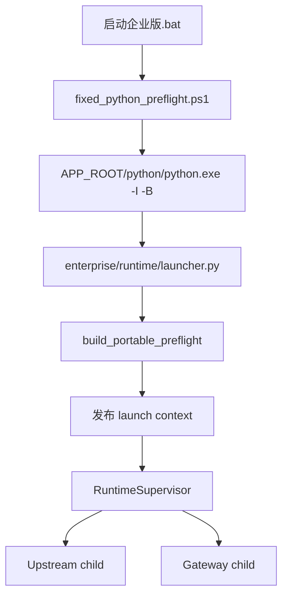

# Runtime、安装、发布与在线更新

2026-10-19 补记：#176 已合并 main e0dfa84，正式发行已为 v2026.10.3，准确构建身份见 [发行记录](../ops/RELEASE-2026.10.3-RECORD.md)。当前独立维护候选新增 Setup v2 的只读 inspect-entry；`install_entry_repair.inspect_fixed_entry` 复用当前完整 Release/入口归属证明，缺登记仅返回 REGISTRATION_REQUIRED，不生成 UUID。GUI 按所选操作刷新并提前检查离线升级，明确停机及关闭固定启动窗口；PermissionError 只在原事务成功回退后映射 WRITE_DENIED，回退不明仍阻断。实际补登记仍由显式 repair-entry 原事务完成，不改 Runtime/数据库/在线更新语义。此候选未发布，范围和验证见 [C6 增量](../ops/OFFLINE-RETAINED-UPGRADE-2026-10-12.md#2026-10-19-页面升级来源的登记预检与维护提示候选)。

> 源码参考快照（2026-10-13）：main@e89a288（已合并 #154/#155/#156）；产品功能源码基点 #156@4bdd9a1 保留；C5/C6/C7 已合并，构建与验收范围仍引用其准确记录。本文是代码/运行参考，当前 PR/CI、Release 和验收只见 [CURRENT](../CURRENT_PROJECT_STATUS.md)，实施顺序只认路线图。

[返回索引](./README.md)

2026-10-23历史发行参考：#195/#196及发行记录#197已合并，10.5/10.6当时发布，后因已知问题调整为预发布。预置包保持Schema2并登记迁移目录，启用包才执行2→4。`build_upgrade_routes.py`曾生成准确路由；旧来源现不推荐在线升级。当前正式Latest为10.10，准确10.9→10.10及10.4→原10.5→10.10已在隔离副本验证，仅按离线原位路径交付；旧10.5验收脚本过早清理导致登记未完成，原安装器显式恢复后通过，失败记录保留；现场设备验收另列。版本、资产和原时点验收见[组合发行记录](../ops/RELEASE-2026.10.6-RECORD.md)与[CURRENT](../CURRENT_PROJECT_STATUS.md)。下文候选说明保留原时点，不作为当前发行状态。

离线版本化规划继续使用安装事务传入的 database_inspector：`plan_migrations` 的可选检查器在 mvp 准备/执行两处传递，防止 WAL 源的普通只读查询产生空旁路后被后续来源核验拒绝。默认在线读取、实际迁移和备份恢复不变；不是允许忽略 WAL。真实 Setup 首次失败及准确修正包验收回记#195。

2026-10-22 离线部门升级续包：#193/#194 已合入main2655bd5；`install_upgrade` 后续候选允许已预置的版本化升级，调用同一个 prepare/execute，不复制DDL或备份器。`mvp.verified_job_database_backup()` 将持久迁移结果与原计划、备份身份交叉核验；恢复仍使用既有 exact-current 检查。恢复数据库文件替换后只登记经原备份证明的新对象身份，再恢复 EXE/Setup；成功任务只继续Windows登记。原Setup页面和权限/停机保护沿用，普通启动不激活新结构。准确候选证据和正式发行仍分别见CURRENT/原PR，下段保留原发行接线时点。

2026-10-22 部门发行接线候选：`canvas_workspace.release_registry()` 为打包/新装/更新提供同一登记目录；`tools/build_release_manifest_v2.py build --database-schema-version 2` 预置目录但保持旧结构，`--database-schema-version 4 --database-contract-mode versioned-forward-migration` 生成启用候选。新安装依包声明应用对应DDL，普通启动不迁移；同结构维护识别已知前缀，跨结构更新要求来源已预置同目录并执行原备份恢复。Legacy migration_ids 沿用正式10.4四项，新增DDL属于 versioned_migration_ids。离线同结构预置/维护复用 install_upgrade，跨结构离线仍拒绝；准确版本/构建/验证状态见CURRENT和新PR，不表示已有正式10.5/10.6发布。

Windows 交接实现 [#157](https://github.com/MEIS-DaCaiTou/Infinite-Canvas-Enterprise/pull/157) 准确 551f433 四项常规 CI 成功、独立审查后已随 `519b1da0` 合并。正式入口“启动并打开”只用当前已安装版本；更新由管理员在更新中心单独确认，不要求每次启动更新。必要安装审查不扩成任意宿主/历史/GUI 工程，业务原任务恢复可并行推进；正式 10.1 资产未改变，新发行另行验证。

更新时间：2026-10-13。主线、维护线和固定入口边界见 [CURRENT](../CURRENT_PROJECT_STATUS.md)，生命周期设计见 [统一交付 ADR](../decisions/ADR-DELIVERY-001-UNIFIED-INSTALL-UPDATE-LIFECYCLE-2026-10.md)。

## 1. PathRoots

`enterprise.paths.PathRoots` 将应用代码与可写状态分离。主要根包括 APP、CONFIG、DATA、LOG、STATE、STAGING、BACKUP、运行时 Python、上传、输出、素材、画布、对话和工作流等。

两种 profile：

- `development`：从源码目录推导，便于开发运行。
- `portable-release`：从 `<INSTALL_ROOT>` 与 current pointer 解析，APP_ROOT 指向 `releases/<release_id>`。

校验包含路径包含关系、目录重叠、同卷要求、Windows 特殊路径、符号链接/reparse point、可写探针和进程全局根一致性。

## 2. Runtime 关键类型

| 文件/符号 | 责任 |
| --- | --- |
| `supervisor.py / SupervisorConfig` | 端口、路径、模式、发布身份和日志配置 |
| `supervisor.py / RoleRuntime` | 单个 Gateway/Upstream 子进程状态 |
| `supervisor.py / RuntimeSupervisor` | 启动、监测、退避、停止、重启与控制命令 |
| `control.py / RuntimeController` | 面向 CLI 的 start/stop/restart 控制 |
| `control.py / inspect_runtime()` | 汇总 state、进程身份、端口与健康结果 |
| `state.py / RuntimeStateStore` | 原子状态读写、锁和 generation |
| `process.py / CommandSpec` | 固定子进程命令定义 |
| `process.py / ManagedProcess` | `Popen` 与进程身份封装 |
| `ownership.py / ProcessIdentity` | PID、创建时间、可执行路径身份 |
| `ownership.py / PortListenerSnapshot` | 端口监听者快照 |
| `health.py / HealthResult` | TCP/HTTP 探针结果 |
| `logging.py / RotatingTextLog` | 有界轮转文本日志与脱敏 |
| `windows.py / ProcessJob` | Windows Job Object 约束子进程 |

主线收敛分支同时包含 `28ad937` 的阻塞隔离/任务回执，以及 `2026.09.4` 现场验证后的全新无 keep-alive 探针、并发单飞、外层截止与启动宽限保持。短暂 readiness 失败先进入 degraded 并允许同 PID 自愈，只有真正的 liveness/稳态连续失败达到策略条件后才退避重启。主要修复已通过 PR #108 合并，不等于每个旧发布包都包含。

## 3. Portable 启动信任链

下图为源码/旧安装 BAT 兼容链路。固定原生入口 #138、安装接线及入口专用修复 #139 已选择性回归 main，不绑定应用目标，不另写 Runtime；这不是完整安装维护产品交付。

`installer/windows/native/` 用 C# 处理固定入口、Windows UI 和受限进程调用：读取 `state/current-release.json`，校验 Manifest 与完整 inventory，再调用该 Release 内 `python/python.exe -I -B enterprise/runtime/launcher.py portable <command>`。`tools/build_native_entry.py` 使用外置固定编译器双构建，仅生成全新 artifact 根，不写客户安装、不迁移数据库。构建、安装器接线和真实 Runtime 验收必须区分，见 [实施记录](../ops/DELIVERY-1-FIXED-NATIVE-ENTRY-2026-10.md)。

正式 Windows 入口从开始菜单或安装目录打开该 EXE，点击“启动并打开”只启动当前已安装版本，不查询/下载新版本，不强制更新。管理员按需在更新中心单独确认更新；关闭启动窗口不停止服务。C8 已合并实现依据已知 Job 权限一次选择进程创建参数，保留独立性/READY/清理核验；在线受阻使用既有停服离线维护，不新增服务/计划任务。单跳实际证据、失败恢复、界面及历史覆盖边界见 [C8 记录](../ops/WINDOWS-START-UPDATE-CLOSEOUT-2026-10-13.md)。



关键约束：

- 只接受当前 Release 内固定 `python.exe`。
- 使用 `-I -B`，并清除 `PYTHONHOME`、`PYTHONPATH` 等污染。
- Manifest、payload tree、Runtime manifest、启动核心文件和 Python identity 必须匹配。
- 端口若被无关监听者占用则 fail closed，不直接杀未知进程。
- `launch_context` 将一次预检的身份绑定到实际 service-host 进程。

## 4. 源码/旧安装兼容批处理入口

| 文件 | 命令 |
| --- | --- |
| `启动企业版.bat` | portable `start` |
| `停止企业版.bat` | portable `stop` |
| `重启企业版.bat` | portable `restart` |
| `查看企业版状态.bat` | portable `status` |
| `企业版健康检查.bat` | portable `health` |

`enterprise.runtime.cli` 还定义 `foreground` 和内部 `service-host`；后者需要可信 instance ID 与 launch-context identity，不是人工常规入口。

根目录 `run.bat`、`启动服务.bat` 直接运行 `main.py`，属于旧 Upstream/开发入口，会绕开企业登录与权限，不应作为企业正式启动方式。

## 5. Release 模型

### `enterprise/release/current_release.py`

`CurrentRelease` 描述当前 release ID 与前序信息；读取函数严格解析 `state/current-release.json`，写入使用临时文件、身份校验、原子替换和目录同步分类。

### `enterprise/release/release_manifest_v2.py`

核心类型：

- `ReleaseManifestV2`：固定 schema 的发布身份、归档、payload、Runtime、静态树、配置和数据库契约。
- inventory 项：路径、大小、SHA-256 等。
- 构建/解析/验证/materialize 函数：拒绝绝对路径、穿越、重复、ADS、设备名、symlink/reparse 和闭包外文件。

### `release_builder_v2.py` 与 `static_build.py`

从干净 Git 身份构建确定性静态树和 Release archive，绑定 commit/tree/manifest/inventory，避免从脏工作区制作不可追溯发布包。

统一基线默认 snapshot 为正式 09.9/10.1 同源 v2。构建参数 `--database-contract-mode` 支持默认 `same-schema-no-migration`、明确改表的 `versioned-forward-migration`，以及维护构建的 `same-versioned-schema-no-migration`（wire 仍为同结构/code-pointer）。构建模式不能代替准确 source/target route、registry 和安装副本验收；本轮不改 VERSION、不发布新包。

### Windows Runtime

`windows_runtime_build.py` 和 `runtime/windows/` 策略固定 CPython 3.14.6 x64、锁定 requirements、wheelhouse 闭包、pip-check、SBOM、来源与可复现构建证据。当前开发、企业 CI 与 Runtime 专项对齐发行依赖，测试工具另行锁定；开发解释器与已安装 portable Runtime 仍是不同对象，不能修改客户 Runtime 来安装测试工具。

## 6. 首次安装

以下为 fresh-install 实现，不是完整更新/修复/卸载产品。主线 #139 已将快捷方式指向 `<INSTALL_ROOT>/InfiniteCanvas.exe`，新装要求与 Release 同 commit/tree 的独立原生构建。main #152 已使用 `Uninstallable=RegisterLifecycle`、实例卸载登记和保留数据事务实现标准卸载；首次安装不等于完整维护矩阵。已公开客户包不因主线合并自动变化。

`fresh_install.py` 的主要阶段：

1. 校验 manifest、inventory 和 archive。
2. 校验安装根、路径不重叠、固定磁盘与 reparse 边界。
3. 创建 config/data/log/state/releases 等目录。
4. materialize 不可变 Release。
5. 创建 Greenfield SQLite 数据库和首个超级管理员。
6. 发布配置、数据库和可选固定入口/实例记录；current pointer 最后发布。
7. 失败时只清理本次拥有的对象，不删除外部未知文件。

数据库创建前重新校验已 materialize 的 schema evidence 哈希，按受支持的 v1/v2 版本和精确 registry 初始化；创建后核对 schema 哈希、版本和账本。无版本/未知 evidence 拒绝新装，不靠显示版本猜测，不删除主线的固定入口、最大密码长度或最终 pointer 发布保护。

`install_setup_bridge.py` 通过当前用户 SID 约束的 named pipe 接收安装器输入，避免在命令行或环境变量中暴露密码。

### 已接线的入口专用修复

`enterprise.install_entry` 只负责固定入口和实例元数据，不是第二套数据库/升级引擎：

- `state/installation.json` 保存独立 UUID、角色/范围、位置、相对数据/配置路径、更新协议、通道和原生构建身份；不复制当前应用版本，版本只认 current pointer。
- HKCU 本产品子键是定位提示，不是可信安装证据；最多读取 32 条，不扫描所有磁盘。一个已登记位置优先使用原处，多个要求选择；未登记历史位置需显式选择并校验。
- `repair-entry` 完整核验当前 Release 和未完成恢复作业，只发布根 EXE 与 STATE_ROOT 元数据/入口备份，不打开数据库、不改变当前指针、不创建管理员。`enterprise.install_entry_repair` 用 v2 不可改写 plan/result、runner lease 和 Runtime fence 保存可恢复事务；`recover-entry` 通过同 SID v2 管道显式恢复已知事务。
- 共用 `system-update-active.lock`，原文件和写入文件都以内容＋文件身份约束；中途失败只恢复本次拥有的两个入口文件。未知文件、移位实例记录、重解析或已有锁阻断。
- 不能证明入口恢复时保留锁及备份，不能删锁试错。新 v2 事务可在完整身份核验后恢复原件，已成功时只完成收尾；两卷的 marker 分别保留在目标同卷目录。旧 v1/未知锁缺乏这些证明，仍不自动接管。`ROLLED_BACK` 不等于入口修好，Setup 不继续创建快捷方式/启动；准确门禁见 [入口恢复记录](../ops/ENTRY-REPAIR-RECOVERY-2026-10-10.md)。下面的程序修复不接管这些旧锁。
- 新装对未支持的过深目的路径做写入前阻断，不更改 Windows 长路径策略；这不是宣称已兼容任意长路径。

本轮增量候选在环境页与最后准备页明确安装根和“只修复入口、不是业务升级”的范围，不填写旧安装管理员密码；最终仍由 Python 完整核验，不以页面目录形状替代资格。真实安装副本/服务测试入口与其权限和证据边界见 [测试说明](../../enterprise/tests/README.md)。portable host 的路径修正保留 containment 校验，同时维持可信 KnownFolder 的原目录身份，避免 Windows 目录重定向被 `resolve()` 替换后导致 context 不匹配；不放宽完整进程/文件身份校验。

### 同 Release 程序/Python 修复与图形维护候选

`enterprise.install_repair` 提供 `repair_program()` / `recover_program()`，已由 #141 合并到 main，保留 v3 named-pipe handler。新候选将 Inno 的程序修复/恢复/只读状态接入 v4，v1/v2/v3 仍兼容。它复用 Manifest v2 资产校验/物化、既有安装身份和 Runtime；不是第二套业务升级/数据库引擎。

- 只接受已登记实例、准确 current pointer 与同一 Manifest 的外部完整资产；允许已知程序文件损坏或缺失，不把未知额外文件/目录当本项目文件搬走。
- 服务必须已停止，任务确认必须显式为 true。读取当前用户 Runtime 状态/进程/端口，未知状态阻止；不杀进程或删除旧锁。维护 fence 与启动预约后复查防止修复/启动竞争。
- 在 `staging/program-repairs/<操作短 ID>/` 准备完整候选、不可改写的 plan/result 和 kernel lease。执行器退出由操作系统释放 lease；第二执行器不能抢占仍存活的操作。
- 只替换停止状态的当前程序目录；保留 original/rejected 作为证据，不改数据库、配置、素材、画布、账号、根 EXE、实例记录或版本指针。
- 中断后只恢复自身 plan/hash/文件身份一致的事务。已记录成功且新树一致时完成释放；成功记录前恢复修复前原树。**回退到原损坏树不等于已修好**，可在核验后再次修复。身份/指针/备份/锁变动时保留阻断，不能猜测清理。

`enterprise.install_repair_status` 是展示层，不是事务授权来源：

- `RepairProgress` 在 STATE_ROOT 保存当前操作索引，在该操作的 STAGING_ROOT 保存绑定身份、指针、原树与 runner 的阶段。phase 不代替不可改写的 plan/result，也不能证明修好。
- `inspect_program_repair()` 只观察已知事务，不执行恢复；OS lease 存活表示仍在运行，执行器退出且维护锁未释放表示需要恢复。只有匹配结果与程序树才能报告成功/已回退；旧 v3 没有进度文件的已知 plan 也能查看与恢复。
- v4 进度通过同 SID 管道显示 allow-list 阶段；断开只结束查看，不杀后台执行器、不触发回退。重新打开向导可选择只读状态，运行中显示当前阶段，回退明确提示原损坏可能仍在。
- 向导将外部解释器完整包放在本产品当前用户 `maintenance-payloads` 缓存下，避免关闭 Setup 时删除仍运行的解释器。重解析/空间校验不省略；main #151 的 install_cache.py 已在显式拥有者及运行/恢复引用核验后清理准备副本；不能按目录名称、年龄或未知历史身份自动删除。
- 程序维护不执行快捷方式、安装登记或数据库写入；只有新装/成功入口维护才进入对应后续步骤。所有维护 operation 的外部解释器包持久保留，不因 Setup 关闭或管道应答而猜测 backend 已退出。图形按钮接入与编译通过不等于真实图形点击验收。

上述同版程序修复本身不执行业务升级/数据迁移或接管历史未知身份。main #151/#152 后续提供缓存清理、保留数据卸载与同版重装；#154/#155 已合并执行器/连续升级实现。断电/磁盘故障及全部 GUI 仍不宣称已验收；准确记录回到 CURRENT 和 DELIVERY-1。

## 7. 在线更新

C6 `enterprise/install_upgrade.py` 在停止来源服务后复用 `UpdateMvpService`/`execute_update_job`；只处理准确安装身份及已知相同 Schema。共享引擎的显式数据库检查器让该离线调用复用经过身份、静止状态和旁路文件核验的 immutable 读取；在线调用仍用原默认读取，不忽略 WAL/SHM/journal。准备副本使用完整 Job ID 的同卷隐藏短目录，目标仍由 Manifest/Job 绑定。原程序保留恢复沿用 C3，原生 entry/record/Setup/support 对象有独立不可变计划和发布检查点；成功目标先等待 Windows 登记，不因登记失败回退其业务数据。`install_setup_bridge` v7 不接收凭据或任意 Setup 文件路径，Windows 包装父进程和登记解析在平台适配器。目标等待登记的 HTTP/WS 暂停不代表完整业务维护态。源码、完整副本与 GUI 验收分列，见 [C6 记录](../ops/OFFLINE-RETAINED-UPGRADE-2026-10-12.md)。

```mermaid
sequenceDiagram
    participant UI as Update Center
    participant API as update_api
    participant GH as GitHub Releases
    participant ST as Staging/Job Store
    participant RT as Runtime
    participant DB as SQLite / backup
    participant PTR as current pointer

    UI->>API: check
    API->>GH: list fixed-repository releases
    UI->>API: prepare(release id)
    API->>GH: download manifest/inventory/archive
    API->>ST: verify and create READY job
    UI->>API: execute(password)
    API->>ST: reserve, state=UPDATING
    API->>RT: job-id-only handoff
    RT->>RT: controlled stop
    RT->>DB: re-read plan, backup, migrate, verify schema
    RT->>PTR: compare and switch
    RT->>RT: start target and health check
    alt target fails
        RT->>RT: confirm target stop; unknown means RECOVERY_REQUIRED
        RT->>DB: restore expected-current backup
        RT->>PTR: restore source pointer
        RT->>RT: restart source release
    end
```

核心组件：

- `GitHubReleasesProvider`：只接受固定 GitHub 仓库、Manifest v2 Release 和精确资产集合。
- `SafeHttpClient`：限定 HTTPS、Host 和重定向；跨 Host 去除敏感请求头。
- `atomic_download()`：限制大小，边下载边哈希，完成后原子发布。
- `UpdateJobStore`：持久化 plan/status/events，限制单个活动执行保留。
- `UpdateMvpService`：准备并验证同 Schema或显式版本化迁移更新，持久化数据库计划。
- `execute_update_job()`：重读迁移证据、备份/迁移、pointer 切换、启动/健康、数据库恢复和代码回滚。
- `request_portable_update_handoff()`：只把 job ID 交给 Supervisor 控制通道。

main 派生的生命周期诊断增量为每个实际执行的 `target_start/target_health/target_stop/source_start/source_health` 保存 started/result 事件及 status 摘要，绑定 Release、命令、退出码与白名单 stage/errno/winerror/bootstrap 类别；不存原始 stderr、异常正文、环境或密钥。`failure_code` 保留最初失败，最终 `result_code` 表示更新/恢复结果，两个码不能互相替代。未执行阶段不补猜测值。准确实现/验证边界见 [实施记录](../ops/RUNTIME-UPDATE-LIFECYCLE-2026-10-09.md)。

2026-10-23诊断导出候选只调整`recent_diagnostics()`的尾记录选择：500条总上限按来源分配最新记录，低limit优先升级事件及supervisor/launcher，截断返回SOURCE_LINE_LIMIT/partial；原字节上限、过滤、脱敏、状态摘要和ZIP结构复用。该修复未进入正式10.5/10.6，不能据此宣布现场handoff故障解决；范围及93项定向结果见同一实施记录。

同日后续候选在`handoff_lifecycle`统一就绪/请求/控制等待为60/120/135秒，供Supervisor和Controller复用。正式10.5原完整校验/探测隔离实测首次28.419秒，超过原5秒就绪时限；新预算保持身份、完整性、提交取消及未知清理判定，OS探测仍3秒，不自动重试。三个定向文件178项通过，尚非已发行修改或客户恢复；10.4原控制器不因此改变，具体边界见原实施记录。

现场未提交首跳的显式恢复候选为`tools/recover_uncommitted_update.py`：使用安装内source Python和原模块，默认check，`--recover`需原升级超级管理员密码。限定原指针/未提交/无执行数据/同作业预约；核验source数据库和正式健康后在原commit gate中释放该预约，复用clearance审计及sequence.stop，不直接删fence或执行版本升级。工具及原clearance合计15项定向通过，准确10.4 CP314/SQLite/文件槽位兼容专项通过；该本机专项的Runtime启停与登记为注入。负责人随后执行恢复包并确认原画布恢复，回执仍为10.4且upgrade_executed=false，补齐单台现场结果。10.5/10.6原资产保留，预发布标记使原稳定路由不再匹配；旧10.4/10.5公开目录实查均不提供升级。10.7修复交付先走离线，旧源程序不会因发布新目标自动获得补丁。

## 8. 更新限制

- 2026-10-24准确10.7的Setup登记/Schema2→4及真实在线交接成功、目标失败恢复、原任务GET续查已验证，已按冻结源码1b4808f正式发布并完成8项公开回读。发布时实现仍在#199，主线合并另行确认。测试目标10.8未发布，在线补验是Schema4同结构程序恢复；原跨结构恢复证据单列。实际状态及首跳脚本限制见[10.7记录](../ops/RELEASE-2026.10.7-RECORD.md)，不能据此认为旧10.4源控制器已获在线修复。
- 10.7的`mvp._database_contract_mode()`将完整Schema证据相同的forward目标交给既有同结构规划，覆盖已激活10.6的维护；实际数据库和完整registry仍验证。目标包按离线交付且不声明旧源在线路径，不能靠新目标改变旧源控制器。准确包/验证边界见[10.7发行记录](../ops/RELEASE-2026.10.7-RECORD.md)。
- Update Center 支持相同 Schema 单跳升级，以及经过 registry、Manifest v2 和当前数据库身份共同约束的版本化前向迁移。
- 版本化迁移在 pointer 切换前创建一致性备份；目标启动或健康失败时按 expected-current 约束恢复数据库、pointer 和 source Runtime。
- 如果迁移已提交但结果尚未返回就发生异常，不能凭 `MigrationResult` 缺失推断数据库未改变；执行器必须复核持久化的 source pointer 与 schema 身份，无法证明一致时进入 `RECOVERY_REQUIRED`，不得启动旧版。
- `RECOVERY_REQUIRED` 表示无法证明三者已经恢复一致，不能自动重试或伪装成普通失败。
- 恢复数据库或 source pointer 之前先确认目标停止；非零退出不继续恢复或启动 source，保留恢复阻断。source 启动失败时不虚构后续 health 调用。入口退出 0 但没有有效结果文档仍判为失败。
- 维护线已发布 09.9 改表目标，并有测试设备受控桥接成功反馈，不外推 main 已统一交付或全部客户批准。
- main #153 的 `release_catalog.py` 已共用 v1/v2 分页、全页条件核验和完整性失败阻断，最多 1000 条，细节见 [目录记录](../ops/UPDATE-CATALOG-PAGINATION-2026-10-11.md)。`route_catalog.py::RoutePreviewCache` 只优化页面不可变路线预览，prepare/execute 不读该缓存。main 规划最多 8 跳；#155 已合并一次授权连续执行/检查点，在线继续仍有 handoff 资格阻断。09.6 治理激活状态不能由旧更新器直接识别，不删审计对象绕过。
- 完整通知/任务和业务写入隔离、更新器自更新及图形恢复仍待落地；业务写入已开放后不盲目回旧备份。
- 更新中心只消费完整 Manifest v2 Release，不消费 GitHub 源码 ZIP。
- 诊断输出有界并脱敏，但仍应按内部运维材料处理。

## 9. 主线安装维护与候选升级边界

main 的 install_lifecycle.py 为已登记实例提供保留数据卸载、同版重装、自己的恢复及 inspect_lifecycle 观察；install_cache.py 只清理可证明的维护准备副本。未知对象、客户数据和恢复依赖保留。

C5 的 updater.py / updater-worker-v1 契约选择目标 Python 执行器并绑定准备/READY/接受过程；C6 install_upgrade.py 复用现有更新引擎处理限定相同 Schema 的离线升级/保留数据跨版本重装；C7 sequence.py 等协调一次授权路径、逐跳权限、检查点、当前跳恢复及原生维护资产。上述新增升级代码已随 #154/#155 进入 main，本 Wiki 所在产品修复分支已整合该主线；参见 C5/C6/C7 实现记录。

限定 GUI 状态：#152 本身的卸载 Yes 点击未验收；C6 后续合成安装副本已有 Yes 与限定跨版本重装点击证据；代码已随准确 10.2 正式发行，限定 GUI 证据不外推。C7 冻结包完整两跳成功，原在线继续曾被 SYSTEM_UPDATE_HANDOFF_JOB_BLOCKED 阻断；C8 的真实单跳/恢复成功不覆盖全部 C7 在线路径。不能把冻结构建等同新 Head 或把 HTTP/WS 暂停称为完整任务排空。

## 2026.10.2 发行源码与资产身份

负责人已批准本轮修复版构建和验证后发布，`VERSION=2026.10.2` 用于准确 Git 提交的同源 ZIP、EXE 与 Setup；见 [发行记录](../ops/RELEASE-2026.10.2-RECORD.md)。源码/PR/CI、准确包验收、正式 Release 与客户更新分别记录，构建完成不能直接写成已上线。10.1 公开资产保持不可变；发布前使用正式 10.1 合成安装副本验证，不将测试版本改名冒充来源。启动现版本不强制升级，管理员选择是否更新。

## 10.2 发行包的准确升级边界

正式发行 source `7da593b52f3d487033e3ab1771142bfed891f316`，已随 #159 合并，ZIP/固定入口/Setup/维护工具同源。正式 10.1 普通桌面 BAT、包内 Python 和真实更新 worker 已完成准确包单跳成功及目标失败回退：目标 10.2 / 恢复 10.1 各自 healthy，原账号、业务行和配置/画布/素材保持一致。正式发布/CI/回读状态只见 CURRENT 与发行记录。

来源必须匹配正式 10.1 的 READY v2/30 对象身份；10.1 裸新装缺版本账本会被安全拒绝，本次不宣称该来源直接在线升级。验证副本通过正式 10.1 已发布的准确备份/旧库登记 API 建立已登记来源，并保留备份与业务行对照；不手工伪造账本。在线不可用时仍走已有停服离线维护，不能直接覆盖目录。启动当前版本与确认更新分开，界面没有强制升级步骤。

## 10.3 正式发布收口（2026-10-19）

#176 按批准合并为maine0dfa84，合并后文档/Enterprise/Runtime CI成功。正式[v2026.10.3](https://github.com/MEIS-DaCaiTou/Infinite-Canvas-Enterprise/releases/tag/v2026.10.3)的准确构建仍为d8ffe55；固定CPython不重建，9项核心资产与验收字节一致，10.2资产不变。正式10.2原更新检查从公开目录确认stable/direct到10.3，正常启动当前版本与手动确认升级继续分开。准确包成功/失败恢复、CLI与HTTP证据及未覆盖的GUI/客户边界见[原发行记录](../ops/RELEASE-2026.10.3-RECORD.md#正式发布收口2026-10-19)。独立未开始任务恢复候选不包含在该冻结发行中。
