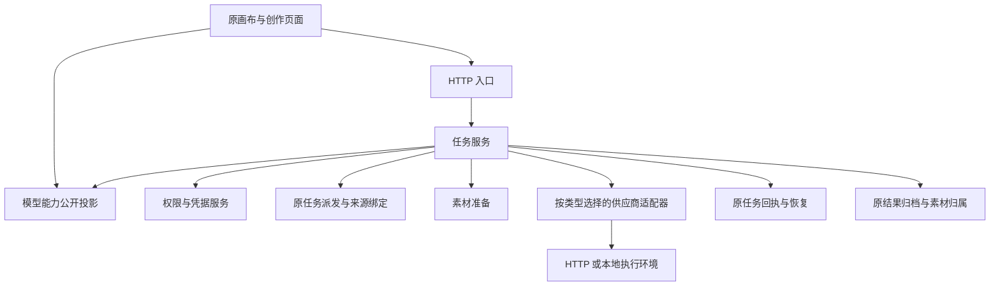

# ADR-PROVIDER-001 供应商模型能力与执行边界

日期：2026-11-20
修订：2026-11-25（MKT-02 复用模型能力、原任务与个人尺寸边界；MKT-01 保真未收口）
适用项目：`MEIS-DaCaiTou/Infinite-Canvas-Enterprise`
状态：部分已批准，详细契约为提议；现有实现与目标分开登记。

| 状态 | 适用内容 | 依据与后续记录 |
| --- | --- | --- |
| 后续已批准，本地功能完成，效果覆盖有限 | MKT-02.A–C：公开官网多尺寸状态、独立面板／个人尺寸、原任务与两种尺寸真实补验 | [原记录](../ops/PRODUCT-INTEGRATION-FIXES-2026-10-13.md#mkt-02)；仅用贞贞，追加 3 元后累计预算 13 元；独立任务／全部归档保留，MKT-01 遮挡与全用途保真未由此通过 |
| 已批准，本地接线完成，质量未收口 | MKT-01：三模式 UI、原任务与图层节点；双渠道复杂样本元数据、真实鼠标、能力差异校验 | [原记录](../ops/PRODUCT-INTEGRATION-FIXES-2026-10-13.md#mkt-01)；贞贞同步字段统一，自动分层有效、层数／OCR 暂未落实；方舟自动识别因欠费待验，缺字／遮挡保真仍未通过 |
| 后续真实样本通过，覆盖有限 | S55.C 的官方透明编辑、限量拆层、Alpha／位置／顺序／英文 OCR 与原图层文档导入 | 负责人关闭安心体验模式后恢复测试，两次新任务成功；[真实记录](../ops/PRODUCT-INTEGRATION-FIXES-2026-10-13.md#sup-04-s55-live)；先前账号上限保留历史，UI／复杂样本仍待验收 |
| 后续已批准，本地实现完成、效果验收未完 | SUP-04.S55：Seedream 5.5 双来源与方舟图片协议／旧尺寸算法抽离；原生凭据、参数与任务接线 | [同一集成记录](../ops/PRODUCT-INTEGRATION-FIXES-2026-10-13.md#sup-04-s55)；225 项分批检查与原 HTTP／重启归档通过，浏览器不可用；官方唯一生成被账号用量上限拒绝，负责人要求稍后处理、先汇报本地 |
| 最新已批准，本地实现与验收收口 | 当前聚焦贞贞独立适配与 API 设置固定入口；其他供应商待定，不作为项目推进前置 | 本轮三项批注；[SUP-03.Z](../ops/PRODUCT-INTEGRATION-FIXES-2026-10-13.md#sup-03-z) 登记原页面、207 项分批检查、三 Key 与透明归档的实际范围，源码／发行／生产分开 |
| 初始批准，现按最新约束更正 | 将供应商重构纳入现有体系与稳定编号；SUP-02 的 API 低并发排队随后被否决，保留素材并改按部门容量讨论 | 2026-11-20 的 SUP-00 登记；2026-11-23 更正优先 |
| 提议 | 完整能力字段、结果／错误类型、其他路径抽离及跨供应商容量分配 | 现有能力先复用；跨供应商与生产配置先明确范围，同渠道多 Key 的后续批准见下行 |
| 已实现，覆盖有限 | 贞贞部分模型能力与协议、ComfyUI 客户端、持久回执、调用身份绑定和原任务续查 | [当前架构](../../ARCHITECTURE.md)、[现有代码与核验记录](../ops/PRODUCT-INTEGRATION-FIXES-2026-10-13.md#sup-00) |
| 本地候选 | Seedream 5.5 背景／分层等未提交增量 | [当前状态](../CURRENT_PROJECT_STATUS.md)；不作为 SUP-01 全部实现的证据 |
| 本地已实现，待完整验收 | SUP-01 的 16 个工坊模型能力、共享页面参数与服务端尺寸校验；保留原任务查询 | [SUP-01 验证](../ops/PRODUCT-INTEGRATION-FIXES-2026-10-13.md#sup-01)；此前 89 项参数检查、44 项回归和三处原页面模拟通过，后续五个常用模型真实样本及 SUP-01.E 见同一记录；全组合仍待补验 |
| 最新已批准约束 | 企业 API 节点不增加全用户／同主机／每人限流；供应商不足先讨论部门多密钥、多供应商和上游扩容 | 2026-11-23 负责人明确更正，优先于先前排队方案 |
| 已撤回 | SUP-02 低并发队列、默认提交 2／在途 2／每人 1 及后台面板 | 历史演练保留，代码和界面撤除；[更正记录](../ops/PRODUCT-INTEGRATION-FIXES-2026-10-13.md#sup-02-no-throttle) |
| 后续已批准 | 同渠道多 Key 按新平台任务轮换；SUP-03 图片执行抽离；常用模型真实参数验收总预算 10 元以内 | 2026-11-23 明确批注和费用回复，优先于上表此前待沟通状态；不包含生产改 Key、采购或新供应商数据外发 |
| 本地实现与联合验收通过，覆盖有限 | 原加密版本保存 Key 集合、原快照冻结 slot；共同结果／轮询与贞贞执行边界抽离 | [原记录](../ops/PRODUCT-INTEGRATION-FIXES-2026-10-13.md#asset-1123-and-supplier-followup)；三个模拟 Key 的重启恢复与五个常用模型真实样本，不等于真实扩容或全组合验收 |
| 本地实现与原页面验证通过 | SUP-03.2 标准 Images／Agnes 风格 JSON 请求和既有明确拒绝边界，原素材模块管理编辑文件作用域 | [同一记录](../ops/PRODUCT-INTEGRATION-FIXES-2026-10-13.md#sup-03-2)；175 项定向检查、13 组前后请求、6 项原入口归档及原任务手动续查；剩余协议、真实渠道及生产验收分别保留 |
| 本地实现与原页面验证通过 | SUP-03.3.R 迁出 Responses 编码／后台／SSE／直接返回，首次查询前持久受理 ID 和原查询地址 | [本轮记录](../ops/PRODUCT-INTEGRATION-FIXES-2026-10-13.md#sup-03-3-responses)；203 项分批定向检查、10 组请求对照、9 项原页面归档及重启后两结果续查；不扩大自动查询、真实效果或生产范围 |

本 ADR 承接[长期供应商适配决定](./REQUIREMENTS-DECISION-REGISTER.md#7-2026-10-13-长期供应商适配与临时兼容边界)，细化[模块化单体方向](./ADR-ENV-001-MODULAR-MONOLITH-MIDTERM-ARCHITECTURE-2026-07.md)。调整的是能力、执行和前端之间的职责，实施顺序与批次验收只在[唯一路线图 4.2.1](../roadmap/DEVELOPMENT-ROADMAP-2026-2027.md#provider-compatibility-batches)维护。实现、合并、发行、部署的动态状态只见 CURRENT。

MKT-01 已实现的能力字段为 `supports_layer_limit`、`supports_layer_text_recognition`、`supports_empty_layer_prompt`，在原公开 profile 中表达具体渠道差异。方舟原生为 true；贞贞当前均为 false，源于本次真实参数验证，而不是将模型名称映射成同等能力。新旧拆分 UI 共用 `CanvasLayerSeparation` 的能力选择与参数函数；服务端适配器同样拒绝未落实选项。字段命名转换仅留在贞贞适配器，新拆层用能保留元数据的同步响应，原任务恢复不受新提交能力收窄影响。没有完整新契约框架、Schema、限流或自动换源。

## 1. 事实基线与问题

2026-11-20 通过只读 GitHub API 核对，最新正式版为 [v2026.11.3](https://github.com/MEIS-DaCaiTou/Infinite-Canvas-Enterprise/releases/tag/v2026.11.3)，标签指向 `a5613dabb6307ceeae4d3bdfc67979b78363ccd7`，公开资产 8 项；本次只复核元数据，原资产下载和安装验收引用原发行记录。远端 main 和本地 HEAD 均为 `d8210980d5c773ff91798cac20e8cfb5c14ee92b`。当前 `f2ad` 工作树处于 detached HEAD，含未提交代码，不能仅凭 HEAD 或 VERSION 判断候选内容。源码与预览映射见 SUP-00 记录。

现有 [provider_image_profiles.py](../../enterprise/provider_image_profiles.py) 直接读取贞贞能力；[model-picker.js](../../static/js/model-picker.js) 提供能力读取，两个画布仍各自保留尺寸选项和旧值处理。[main.py](../../main.py) 中的 `generate_ai_image` 同时完成供应商分派、参数和素材转换、HTTP、受理登记与轮询。正常多图用 `asyncio.gather` 并行；[CanvasTaskDispatch](../../enterprise/canvas_task_dispatch.py) 的 semaphore 仅约束 restored 分支。ComfyUI 已有独立公平队列，不能据此推断 HTTP 生图已有相同调度。

按负责人提供的 16 个生产模型名称与正式 11.3 源码离线比对，7 个命中贞贞专用图片目录，另 9 个名称走通用或管理员临时规则。当前候选新增 `seedream-v5.5`、`seedream-v5.5/layer-decomposition` 两条能力，尚未覆盖整批参数一致性。准确名称与命中情况保存在 SUP-00 记录，本轮未读取生产实时配置。命中目录只说明选择了规则，真实调用与所有参数组合的验收另记。

## 2. 模块职责与依赖方向

| 模块 | 负责 | 边界 |
| --- | --- | --- |
| HTTP 入口与装配 | 解析请求，调用业务服务，投影 HTTP 响应 | main 逐路保留薄入口与装配；协议分支随对应批次迁出 |
| 模型能力模块 | 准确模型／模式映射、支持字段与组合约束、公开能力投影、服务端参数验证 | 通用读取通过简单注册映射访问供应商能力；临时规则作为新模型的明确兼容来源 |
| 任务服务与原派发 | 用户／请求身份、来源绑定、持久受理、续查及归档编排 | API 正常并行，不增加全局低限额；ComfyUI 保留自身算力队列，供应商原始字段由适配器转换 |
| 凭据服务 | 验证 Gateway 身份与来源权限，解析当前或原任务绑定的凭据，提供非敏感配额归属 | 明文密钥只进入执行上下文；页面和持久输入仅保存来源引用 |
| 素材准备 | 授权读取，按能力准备提交副本，处理尺寸、格式、体积、Alpha 和上传 URL | 原资产与提交副本分开；权限和归档沿用原素材服务 |
| 供应商适配器 | 请求端点和编码、鉴权头格式、响应／状态／错误转换，按支持能力查询或取消 | 接收解析后的执行上下文和素材；业务数据库、画布保存、用户权限由上层维护 |
| 结果归档 | 保存全部有效产物、元数据、结果归属与原任务关联，恢复本地未完成归档 | 复用现有存储；恢复优先查原回执或已关联文件 |
| 前端公共参数逻辑 | 按能力生成选项，验证模型切换、复制、导入和重开后的旧值 | 两种画布和创作页调用同一语义逻辑，各自保留界面布局和中英文风格 |

图片、视频、对话、工作流按实际操作划分契约。同步 HTTP、流式对话、异步任务和 CLI 可以共享结果语义，执行机制分别保留。`submit`、`query`、`cancel` 按供应商已证实能力提供；回调和取消不作为所有适配器的必选功能。首批使用简单模块和函数／小型类型，具体新文件在对应批次实现时确定。

本轮多 Key 的职责限制：`credential_pool.py` 仅编码一个或多个 Key；现有凭据库仍只加密一个版本字符串，不改数据库结构。`DepartmentGovernance.accept_context` 在短事务内读取同版本最后一条不可变任务快照，选下一 slot，并与来源和版本一起冻结；不逐次统计整段历史，网络执行不持有事务。`bound_secret` 解析原版本和 slot，执行器只取得选定 Key 的鉴权头。用户、部门权限、费用归属和来源选择规则不转移到供应商模块；未知受理不自动换 Key 或模型。多 Key 只是可用渠道分配能力，账号／分组容量是否独立仍属供应商事实。

SUP-03.Z 采用单一 `supplier` 标签表达明确选择的贞贞适配，与既有配置实例 `id` 分离；不引入通用插件框架。`zhenzhen.provider_preset` 提供公开地址／协议／已维护默认型号，原 `/api/providers` 返回该预设供原设置页读取，前端不复制模型参数。`configure_provider` 仅在显式保存所选供应商时统一其原生请求形式；读旧配置及历史恢复仍沿用既有规则。旧 `id=zhenzhen` 或 `ai.t8star.org` 主机可识别，企业代理通过标签识别，原 ID、密钥和来源绑定不会因显示名或新增标签重建。API 设置权限与部门 Key 管理仍归原服务；多 Key 独立额度、透明生成质量与协议／存储代码的验收分别记录，供应商商务或其他平台待定不阻塞本批开发收口。

SUP-03.1 的实际依赖为 `main → zhenzhen.execute_image → image_execution.complete_image_submission`，其他 HTTP 图片结果也调用共同确认；原 `wait_for_image_task` 装配共同轮询。共同模块只依赖 HTTP、状态和提交错误模块，没有供应商反向依赖；贞贞模块不读业务数据库／凭据。原 `(first_image, complete_raw)` 返回结构和 HTTP 错误保留，完整领域结果类型及其他编码分支继续在后续小批次处理。

SUP-03.2 的实际边界为 `main → openai_images.submit_image / submit_json_image`，随后仍调用原共同结果确认。`openai_images` 只依赖 HTTP、标准库和 `submission`；不导入素材路径、main 或业务服务。原素材模块提供编辑文件作用域，适配器只在编辑 POST 期间进入作用域，先关闭句柄再执行已有的明确拒绝兼容分支；URL 转换按需调用原素材回调。main 保留供应商选择、能力验证和服务装配。该批结束时其他编码未迁出，后续 Responses 边界见下段，不把标准 Images 当作全部协议统一。

SUP-03.3.R 的实际依赖为 `main → responses_images`，该模块只依赖标准库与 HTTPX；素材 URL 由原素材服务提供，业务回执通过上层 `on_accepted` 回调写入。后台受理 ID 及其原 GET 地址在首次查询前保存到原 `provider_receipts`；两项身份均不可由后续回包覆盖。`query_endpoint` 是可选的私有回执字段，不进入前端任务投影，也不改变旧回执或数据库 Schema。恢复服务把它交给原查询函数；原 provider／mode／凭据版本校验和当前访问权限继续生效。后台处理中预览不视为完成，完成后复用原全部产物归档；通用 Responses 仍手动续查。SSE 既有分片兼容与明确拒绝后的请求形式切换保留，未知受理、5xx、响应丢失不重新 POST。APIMart／图像视频代理暂保留原实现，待实际使用证据后确定迁移范围。

## 3. 模型能力契约（提议）

### SUP-04.S55 已批准并实现的具体边界

依赖为 `main → volcengine_images → image_execution`；`provider_image_profiles → suppliers → 两个适配模块 → seedream_capabilities`。共同模型模块不依赖供应商、HTTP 或持久化。原生模块承接所有方舟图片请求体、POST 与旧尺寸算法，main facade 只装配原授权素材、鉴权和回调。小目录只维护当前两个供应商，没有引入抽象插件框架。当前图片契约复用 `(first_image, complete_raw)`，全部产物／OCR／位置元数据由原任务服务归档；下方完整领域类型仍是提议，不冒充已落地。

- **模型能力**：普通 5.5 和分层分别声明尺寸、最多参考数、背景与图层选项；页面和提交读取相同来源。官方普通型号与贞贞两个别名只共享模型规则，不混淆具体编码。图层 max_images 是含底图的输出上限，与普通每次生成一张、前端逐张任务分开。
- **同步／异步**：方舟原生图片同步返回，request_id 仅诊断，不伪造轮询路由。贞贞继续原可查询任务 ID 机制。没有结果且无可查询任务身份时仍 unknown，不切源重投；已归档原生结果可以本地回读，但不能据此声称支持官方远端续查。
- **提交／在途**：不增加全局／每人并发闸门；原部门 Key 池只分配新任务，旧任务保留原凭据版本。方舟 SetLimitExceeded 与 AccountQuotaExceeded 归为账号配置／额度问题，不显示为等待即可恢复的流量拥塞；其他 HTTP 错误和 unknown 保持已有分类。
- **素材**：授权解析、尺寸／格式／Alpha 准备与原资产分开，适配器只接准备好的引用。当前素材尺寸／体积策略是项目策略，非官方硬上限；大图和长详情页效果尚需实际样本。
- **历史恢复**：原任务、来源、平台 ID、结果和权限不重建；官方无查询能力时明确告知不能凭 request_id 远端续查。旧 native 尺寸算法经 18 组合对照，旧设置客户端省略供应商字段仍保留已有值。

这套模块边界可用于服务器进程或容器，HTTP 适配器没有 Windows 依赖；**现有运行部署仍未容器化验收**。DPAPI 凭据当前依赖 Windows 身份和机器，后续需为服务器选择可注入的凭据后端，再验证来源绑定、共享素材、历史任务恢复与多进程部署；不因协议抽离就迁库或新增微服务。

| 契约部分 | 需要表达的内容 |
| --- | --- |
| 身份与依据 | `provider_id`、准确 `model`、创作模式、`adapter_id`、`contract_version`；供应商文档／现有成功回执依据和核验日期 |
| 尺寸与画幅 | 自动、固定档位、枚举比例、自定义像素是否可用；边长、倍数、总像素及长短边比例约束；相互依赖条件 |
| 其他参数 | 可用 quality、背景／透明输出、mask、提示词限制；文生图与编辑分别定义 |
| 素材 | 图片／视频／音频数量，单文件字节与像素限制，总请求体限制，格式和 Alpha 要求，JSON／multipart／URL 的具体编码 |
| 输出 | 同步或异步、查询模式、输出媒体类型和多结果；图层数量、透明通道和位置只保留供应商实际返回的事实 |
| 数量 | 页面批量张数、每次供应商请求的 `n`、分层输出上限分别定义；多图拆为子请求时各计一次实际调用 |
| 验证范围 | 参数契约已核对、模拟通过、真实调用样本、现场验证及仍未知的限制分别记录 |

能力模块负责判断与请求规范化，适配器据此构造供应商字段。前端读取公开投影，后端在付费提交前使用同一规则；原图比例需要计算实际比例后判断，自定义尺寸检查组合约束。切换模型保留合法值，无效旧值给出原因和可选修正，用户确认后才保存新值。未知能力明确标识，经管理员确认的临时规则可以继续使用，不能把空能力解释为所有参数可用。

首批覆盖生产配置的 16 个准确名称，清单在 SUP-01 开始时由实际配置核对，并在同一实施记录逐项登记。`ai.t8star.org` 工坊与 `api.seedance.nz` 平价小屋分别维护契约；型号相近或路径同名不作为共享文件限额、字段和并发上限的依据。模型列表查询只证明名称可列出。

2026-11-23 SUP-01.E 参考依据：负责人提供的 [T8-penguin-canvas 固定源码](https://github.com/T8mars/T8-penguin-canvas/tree/6181ef59a1cad449db7466185020711910624c75) 显式区分两套渠道，其工坊 GPT Image2.5 请求分支选择同步 JSON Generations／multipart Edits，并验证像素尺寸和最多 14 个参考图。本地两款生产型号在原能力表内表达 `supports_async=false`、`supports_auto_size=false` 和 `max_references=14`；新请求选择服从该契约，不再根据存在查询端点推断全部型号支持 async。原任务查询按已冻结回执继续执行。客户端页面枚举、代理请求实现、供应商公开契约和真实样本作为不同证据保存；源码不足以确认账号／Key／分组容量，也不足以证明未列出的型号或所有参数组合可用。原始文件与差异见[原记录](../ops/PRODUCT-INTEGRATION-FIXES-2026-10-13.md#sup-01-e)。

## 4. 四项执行边界

### 4.1 同步与异步结果

提议 `SubmitOutcome` 表达 `completed`、`accepted`、`rejected`、`unknown`，携带可用的 `upstream_task_id`、`provider_request_id`、查询模式、结果列表和供应商用量。`TaskSnapshot` 表达原任务的排队、运行、成功、失败或待核对状态。先通过兼容映射接现有字典和 HTTP 返回，逐路引入类型。

- 同步完成可返回字节、URL 或多项结果。供应商生成完成后还需本地归档，页面成功以可读取的已归档结果为准。没有上游任务 ID 的同步接口在断线或进程退出后，按已有正文／结果恢复；无法证明完成时保留待核对。
- 异步回包得到原任务 ID 后，由任务服务先持久化受理与查询绑定，再轮询。HTTP 200、平台本地 `queued`、供应商 `accepted`、本地归档成功分别处理。
- 部分成功逐项登记并复用已有产物，后续续查补齐原子请求。流式文本按已有文本追踪处理，供应商没有恢复协议时不虚构续流能力。

本轮通用协议重启后使用原任务中心手动查询，原回执和上游 ID 保持；未扩展已有自动续查供应商范围。后续新增自动查询路径须有准确查询契约和原 ID 恢复证据，不能因共用 Images 提交编码就推定支持。

### 4.2 提交与在途观测、部门容量扩展

提交连接与已受理在途是不同事实：前者从生成 POST 发送至取得响应，后者包括异步排队、运行和受理未知。两种计数可用于诊断与容量沟通，不能据此自行给所有用户设置较低门槛。2026-11-23 负责人明确否决 API 限流，本地新增的同主机、每人、RPM 和模型名额机制及管理面板撤除，正常 API 保留原并行执行。ComfyUI 的实际算力调度继续独立。

上游出现容量不足时，先确认限制作用于 Key、账号、分组还是模型，再与负责人讨论上游扩容、部门专用密钥、多个独立额度账号或新增供应商。不同 Key 不证明额度独立，同一域名也不证明全部企业账号共用一个容量。未证实的数值保持未知，不用工程默认值冒充供应商事实。

现有来源授权、部门成员、加密凭据版本及任务绑定继续复用。拟议的部门来源池在第一个生成 POST 前选择并冻结经批准来源，原任务续查保留该来源；当前执行只覆盖已验证贞贞绑定，多 Key 负载分配与其他供应商来源接线尚未交付。各来源的参数、费用、素材外发和实际产能分别验收，负责人选择方案后再实施。

大批新任务并行与未知任务重投分开处理。受理不明、断线、进程退出不证明上游未生成，不自动换 Key／供应商再发同一任务；查询及本地归档继续原身份恢复。上述保护不作为对正常新任务设置限流的理由。

### 4.3 素材处理

先验证登录身份、素材归属和允许的外发用途，再从原素材服务读取。按模型能力准备提交副本，保持参考图顺序、全部有效输入和必要 Alpha。单图字节数、解码像素数、转换后的大小、Base64 或 multipart 编码后的总请求体分别检查。原资产不被压缩副本覆盖，不能通过截断参考图消除超限。

已有路径按 1536 缩放或直接传原文件的差异随 SUP-02 收敛，阈值按具体模型核实。直接 URL、临时上传链接和内嵌字节分别处理；上传链接有效期与下载权限在实际提交时检查，内部局域网地址不能直接当作供应商可访问链接。去重和临时副本复用沿用现有资产身份，缓存不绕过权限或把临时链接当长期资产。

SUP-02 提交副本采用现有 1536px 策略，补充单副本 8MiB、编码引用合计与实际请求体各 32MiB 的工程预算，尚未从供应商确认这些为硬限额。合法小 PNG／JPEG／WebP 直接保留字节，大图准备副本，Alpha 不转为不透明 JPEG；超限或无法解码时明确拒绝，保持输入数量及顺序。缓存限于一个平台 API 请求；现有画布的多输出会创建多个平台任务，各任务分别准备，不增加跨请求缓存。JSON 的外部公开 URL 继续由供应商读取；multipart 的远程图先走原素材导入，临时 URL 被上游明确拒绝时记录原错误、不自动重提或上传替代。当前不提供 URL 自动续期或所有供应商上传服务代理。

### 4.4 历史任务恢复

保留原平台任务 ID、子请求索引、owner、来源及凭据版本、供应商任务 ID、提交／查询端点或模式。新回执按需要增加可选契约版本和准确线上的模型名，老回执经兼容读取；不通过重写全部历史记录迁移适配器。

- 从未开始发送的 queued 请求，执行前验证当前权限、配置和参数。旧值不兼容时给出可修正原因，修正需要用户明确操作。
- 已受理任务按原身份和查询绑定续查，模型目录更新不触发新参数校验或改用新的提交端点。Key 轮换沿用原任务凭据绑定策略，查询授权失败保留记录。
- 无上游 ID 且可能已发送的任务保留待核对；已归档结果沿原关联恢复。归档失败重做本地保存，部分完成只补原任务结果，新增生成 POST 为零。
- 普通账号只能读取、续查和复用自己的授权任务与结果，其他用户的任务和图片验证现有 403／404 权限行为。适配器迁移不改变素材归属。

## 5. 错误分类（提议）

错误同时携带 `phase`（prepare／submit／query／archive）、受理确定性、上游状态码、可用任务／请求 ID 和脱敏原因。下表是业务分类，具体枚举名称在 SUP-03 固定；现有 `PROVIDER_SUBMISSION_UNKNOWN` 等公开代码保持兼容映射。

| 分类 | 判断依据 | 处理 |
| --- | --- | --- |
| 本地参数或素材不兼容 | 付费请求前发现非法组合、超限或不可用格式 | 指明字段和可选修正，上游生成请求为零 |
| 本地权限不足 | Gateway／服务端拒绝身份、来源、任务或素材访问 | 沿用原授权响应，不能切换密钥绕行 |
| 鉴权或模型授权失败 | 上游明确 401／403 或模型无授权，保留发生阶段 | 提交明确拒绝时终止；原任务查询鉴权失败时保留受理身份 |
| 频率或分组容量 | 明确 429、Retry-After 或分组饱和消息 | 保留供应商错误并核对容量／授权来源；已有 ID 继续查原任务，正常 API 不新增统一降速；其他 5xx 不直接归为并发超限 |
| 请求解析或协议拒绝 | HTTP／供应商原任务中的完整解析或参数错误 | 记录实际接口、Content-Type、素材数量／字节和阶段；不能单凭 parse 错误认定大小超限 |
| 原任务明确失败 | 查询原 ID 得到可信失败终态 | 记录供应商事实和已有部分结果，后续重新生成属于新的用户动作 |
| 提交结果不明 | 回包中断、不可识别回包，或 5xx 无法证明拒绝且无可查询身份 | 保留 unknown；不自动重复付费提交 |
| 查询暂不可用 | 已有受理 ID，GET 中断、超时或未识别状态 | 保留原任务，按既有续查退避；查询次数不变成生成次数 |
| 本地归档或归属登记失败 | 上游产物已得到，本地保存／索引未完成 | 按原回执恢复归档和结果归属，生成 POST 为零 |

HTTP 状态码、任务终态和受理确定性分别判断。只有明确证明未发送／未受理的情形，才允许按该适配器已验证的规则再次提交。保留现有明确接口拒绝后的兼容路径和安全 GET 重试边界，迁移时逐条验证。异常原文脱敏，日志不保存 Key 或完整素材正文。

## 6. 验收记录和范围控制

每批使用[既有产品集成记录](../ops/PRODUCT-INTEGRATION-FIXES-2026-10-13.md)追加带工作编号的小节，任务续查细节可引用[原任务工程记录](../ops/PAID-SUBMISSION-STOPLOSS-2026-10-13.md)。每条记录包含工作编号和验收项、准确 Base／Head 与未提交差异、涉及模块、原页面路径、普通账号角色、输入规模、预期／实际结果、提交与查询计数、回执／归档证据、未覆盖项和下一动作。真实调用另记预算授权、准确模型／渠道、原任务身份和供应商报告费用范围，密钥留在本地凭据服务。

| 证据类型 | 能验证的内容 | 记录限制 |
| --- | --- | --- |
| 源码核对 | 版本、依赖、参数规则和执行分支 | 不代表页面或供应商运行通过 |
| 模拟与原页面联调 | 请求字段、非法调用为零、排队计数、故障与恢复、普通账号权限、归档 | 明确假供应商和夹具范围，不能写成真实模型效果或供应商容量 |
| 真实调用 | 指定账号、模型、模式、素材和参数的一次实际端到端链路 | 不外推其他模型／分组；部分字段缺失时保留未知 |
| 现场验收 | 指定正式包在测试机／生产机从原入口完成的操作 | 记录设备、包身份、场景与验收人；安装成功不代表模型兼容全覆盖 |
| 文档检查 | 登记、日期、链接和现有文档契约 | 不能替代业务运行验收 |

开发每轮开始核对 CURRENT 中的当前工作编号、路线图模块范围和验收项，结束时逐项更新证据与状态。新增范围先写收益、依赖及对当前批次的影响，再按负责人决定排入编号。已批准项按原范围推进；提议项不写成既成实现。授权粒度和原页面验收沿用[开发工作流](../../CODEX_WORKFLOW.md)，不增加单独产品审批页面。

## 7. 取舍与实施状态

采用渐进抽离可以保留原页面、任务事实和部署方式，先解决参数与负载故障，再收缩主入口。代价是迁移期存在旧函数包装和可选字段，需要按原回执、原参数和原入口逐路对照。新增同协议模型的目标是只维护能力和映射，新协议增加适配器及对应契约测试。

本轮没有引入分布式 Worker、全量数据库迁移、第三方队列或动态插件框架。这些选择只有出现实际部署需求时才评估。供应商容量、文件阈值、真实模型效果以及全部路径迁移均有独立证据范围，具体批次完成条件见路线图。SUP-00 文档化不改变现有生产包或其他本地候选的验收结论。

2026-11-21：SUP-01 已在原能力／前端公共模块中实现准确模型、参数选项和新提交前校验。此实现没有引入完整 `SubmitOutcome` 类型、配额恢复、通用注册表或新错误枚举；它们仍按对应批次维护提议和实现状态。本地 HTTP 400 继续表达生成前参数错误，已受理任务按原身份查回执。Seedream v5-pro 只开放有公开客户端依据的五个尺寸，完整自定义约束待证实；不能将此维护范围描述为供应商所有尺寸的事实。

2026-11-23 更正：负责人否决 API 限流，撤除图片队列、默认低限额和管理面板；素材准备独立接回原并行图片路径。部门来源授权、凭据版本及原任务绑定已有基础，来源池／负载分配及其他供应商绑定仍待方案确认。低并发历史演练不作为当前实现或容量验收。

现有单体职责可以沿用到未来服务器／容器部署，协议适配与纯参数规则不依赖 Windows。首次迁移可继续单一任务协调进程，并明确持久数据卷、媒体地址、凭据实现与整套备份恢复；DPAPI、进程生命周期和本机路径由原平台适配层处理。多副本或独立 Worker 需要先完成领取／在途状态协调、跨进程事件和恢复验收，不能只增加容器副本数。这里记录设计兼容条件，不把本批 Windows 预览写成服务器或容器已经验收。
